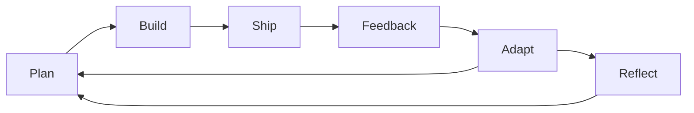

**Agile** organizes software development around fast, flexible response to change, not around following an up-front plan. Self-organizing, cross-functional teams deliver running software in short cycles, so value reaches the customer while their needs are still current.

## Core Concepts

Requirements Volatility
: Unpredicted challenges during production: customers changing their minds, evolving technologies, shifting markets

Empirical Approach
: Accepting that the problem cannot be fully understood before starting, and maximizing the ability to deliver while adapting to feedback

Method Tailoring
: Adapting the development approach to the situation of a specific project rather than adopting a process whole

## The Manifesto Values

Summarized from the [Agile Manifesto](https://agilemanifesto.org/). Each value ranks one thing above another; the second still matters, only less.

| Put first | Before | In practice |
| --------- | ------ | ----------- |
| **People and how they work together** | Fixed procedures and tooling | A motivated team that organizes itself gets more done than a well-defined process does |
| **Software that runs** | Complete written specifications | Running software tells you more than any document about it |
| **Working with the customer** | Bargaining over terms | Needs cannot all be known at the start, so the stakeholder takes part the whole way through |
| **Adapting to what you learn** | Keeping to the schedule | A plan is an early guess; let the work change it |

## The Twelve Principles

Restated after the [principles behind the Manifesto](https://agilemanifesto.org/principles.html); the original wording is there.

| # | Idea | In practice |
| - | ---- | ----------- |
| 1 | Value early and often | Customers are kept happy by useful software that arrives soon and keeps arriving |
| 2 | Change is welcome | New or changed needs are accepted at any stage, late ones included, when they help the customer |
| 3 | Short release cycles | Ship running software every few weeks to a few months; shorter is better |
| 4 | Business and engineering side by side | Business staff and developers work with each other every day until the project ends |
| 5 | Trust the people | Staff the project with people who want to do it, give them the setting and support they need, and let them get on with it |
| 6 | Talk in person | Inside a team, direct conversation carries information better than documents or messages |
| 7 | Progress means running code | Judge how far along a project is by what works, not by documents written or hours spent |
| 8 | A pace that lasts | Sponsors, developers and users should be able to keep the same speed with no end date — no crunch |
| 9 | Engineering quality | Steady care for clean code and sound design keeps the system easy to change, and so keeps the team agile |
| 10 | Simplicity | Do the least work that solves the problem; every task you can skip is a gain |
| 11 | Teams that organize themselves | The team, not a manager, decides who does what; design, architecture and requirements turn out best when the people doing the work shape them |
| 12 | Regular reflection | On a fixed schedule the team reviews how it works and changes its habits to improve |

## Agile Practices

| Practice | What it is |
| -------- | ---------- |
| **Acceptance Test-Driven Development (ATDD)** | Agreeing acceptance criteria as executable tests before the work starts, written by business and developers together |
| **[Behavior-Driven Development (BDD)](../04-development-process/05-testing.md#behavior-driven-development-bdd)** | Specification by example: describing behavior in a shared language that doubles as the test |
| **Iterative and Incremental Development (IID)** | Building in repeated cycles, each adding working functionality rather than one more partial layer |
| **[Test-Driven Development (TDD)](../04-development-process/05-testing.md#test-driven-development-tdd)** | Writing a failing test before the code that satisfies it, in short red-green-refactor cycles |
| **[Pair Programming](../04-development-process/02-code-review.md#review-types)** | Two developers at one keyboard, so the code is reviewed as it is written |
| **Agile Modeling** | Keeping models and documents only as detailed as the work in hand requires |
| **Cross-Functional Team** | One team holding every skill needed to deliver, so work does not queue between departments |
| **[Continuous Integration (CI)](../04-development-process/03-ci-cd.md)** | Merging to a shared mainline frequently, with an automated build and test on every merge |
| **Information Radiators** | Displays that make progress visible without anyone asking: scrum board, task board, burndown chart |
| **[Refactoring](../04-development-process/05-testing.md#test-driven-development-tdd)** | Changing the structure of code without changing its behavior, to keep it workable as it grows |
| **Agile Testing** | Testing continuously through the iteration rather than as a separate phase after it |
| **Timeboxing** | Fixing the time available and adjusting scope to fit, rather than moving the deadline |
| **User Story** | A requirement stated from the user's point of view, small enough to finish inside one iteration |

## Agile Methods

Grouped by what each method is built around:

| Focus | Methods |
| ----- | ------- |
| **Iteration** | [Scrum](03-scrum.md), Agile Unified Process (AUP), Dynamic Systems Development Method (DSDM) |
| **Flow** | Kanban, Scrumban, [Lean Software Development](01-lean.md) |
| **Engineering** | [Extreme Programming (XP)](04-extreme-programming.md), Feature-Driven Development (FDD) |
| **Adaptive** | Adaptive Software Development (ASD), Crystal Clear Methods |
