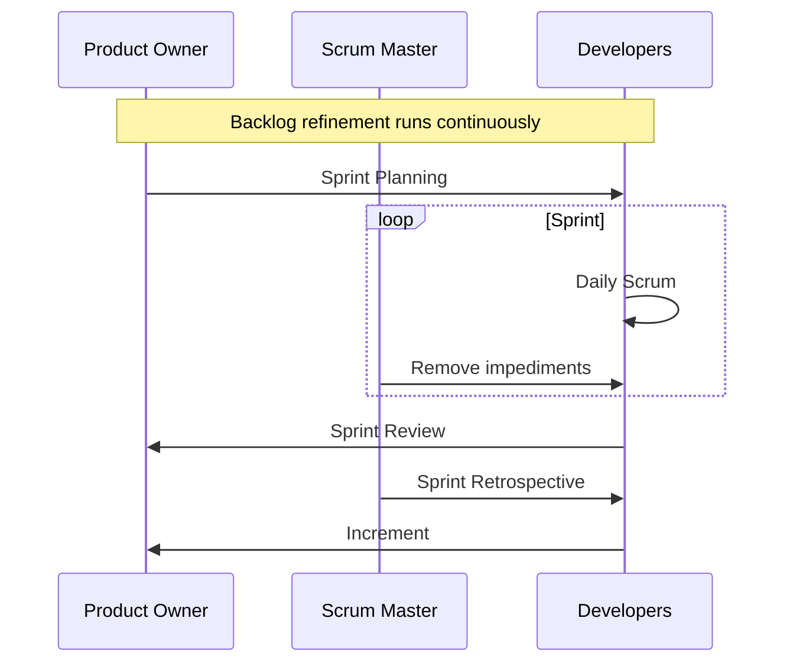
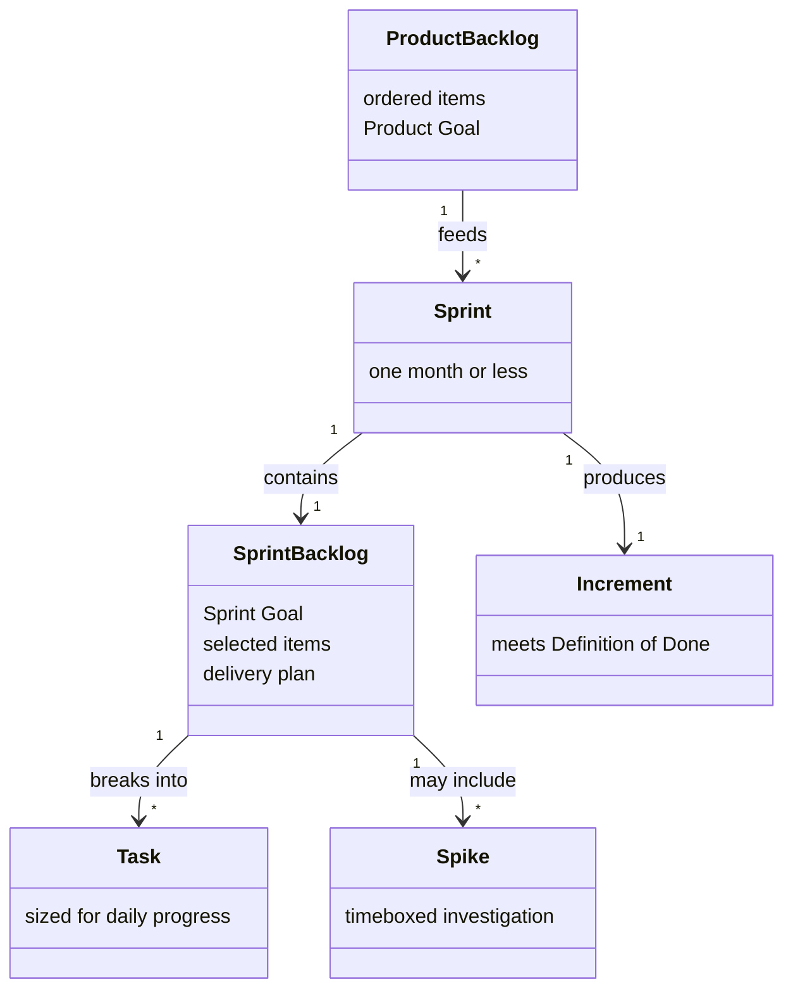

**Scrum** is a minimal framework for complex product work. The team ships a working Increment in short, fixed cycles, then inspects it and adapts. This [empirical](02-agile.md) loop replaces a plan made when the least was known. Terms follow the 2020 Guide; much older material uses earlier ones.

## Pillars and Values

| Pillar | Means |
| ------ | ----- |
| **Transparency** | Those who do the work and those who receive it can see it and its result |
| **Inspection** | Frequent checks of progress toward the goals, against real output |
| **Adaptation** | The plan or process changes as soon as a check shows drift |

**Values:** commitment, focus, openness, respect, courage.

## The Scrum Team

One Product Owner, one Scrum Master and the Developers: one flat team, no sub-teams, no hierarchy. *Developers* (2020) replaced the *Development Team* of older texts; it is an accountability, not a team within the team.

| Accountability | Answers for |
| -------------- | ----------- |
| **Product Owner** | Product value; owns the Product Backlog and the order of its items |
| **Scrum Master** | Team effectiveness; Scrum understood and practiced as the Guide defines it |
| **Developers** | A usable Increment every Sprint, built to the Definition of Done |

## Scrum Events

The Sprint holds the other four. Each event is a planned inspect-and-adapt point: skipping one saves no time, it removes a check.

| Event | Purpose | Timebox |
| ----- | ------- | ------- |
| **Sprint** | Fixed-length cycle; the next starts the moment one ends | ≤ 1 month |
| **Sprint Planning** | Set the Sprint Goal, choose Product Backlog items, plan the work | ≤ 8 h |
| **Daily Scrum** | Developers check progress toward the Sprint Goal and adjust the next day's plan | 15 min |
| **Sprint Review** | Team and stakeholders examine the Increment, then update the Product Backlog | ≤ 4 h |
| **Sprint Retrospective** | Review how the Sprint went; pick the improvements most worth doing | ≤ 3 h |

The hour limits are for a one-month Sprint. Refinement runs all the time and is not an event: the Product Owner and Developers detail, order and size Product Backlog items as upcoming work becomes clearer.

## Scrum Artifacts

Three, each with a commitment that sets its aim. Whatever else a team tracks is a local practice.

| Artifact | Contents | Commitment |
| -------- | -------- | ---------- |
| **Product Backlog** | Everything known to improve the product, in order | **Product Goal** — the long-term target |
| **Sprint Backlog** | Sprint Goal, chosen items, delivery plan | **Sprint Goal** — the one objective that holds the Sprint together |
| **Increment** | Usable result, built on all earlier ones, that moves toward the Product Goal | **Definition of Done** — the quality bar for calling work complete |

## Supporting Practices

Common around Scrum, outside the Guide, and optional: dropping any is still Scrum.

| Practice | What it is |
| -------- | ---------- |
| **Task** | Piece of a Sprint Backlog item, small enough to show progress at each Daily Scrum |
| **Spike** | Timeboxed research or prototype that answers a question before estimation |
| **Story Point** | Relative size of a backlog item: effort, complexity and uncertainty together, on purpose not hours |
| **Velocity** | Story Points done per Sprint, averaged over recent Sprints to size the next plan |
| **Sprint Burn-down Chart** | Daily plot of Sprint Backlog work left |
| **Release Burn-down Chart** | Work left in a release, counted in Product Backlog items |

## References

- Facts follow *The 2020 Scrum Guide* by Ken Schwaber and Jeff Sutherland ([scrumguides.org](https://scrumguides.org/))
- The Scrum Guide is licensed CC BY-SA 4.0; this page summarizes its facts in its own words.
