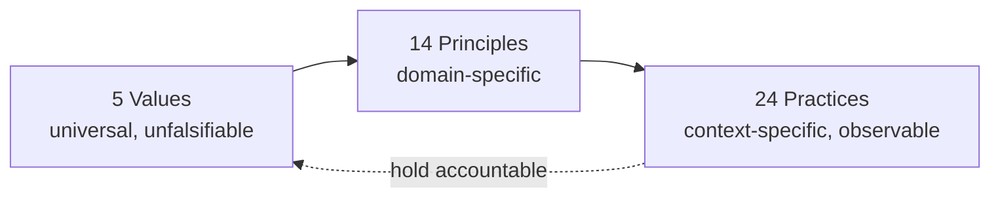
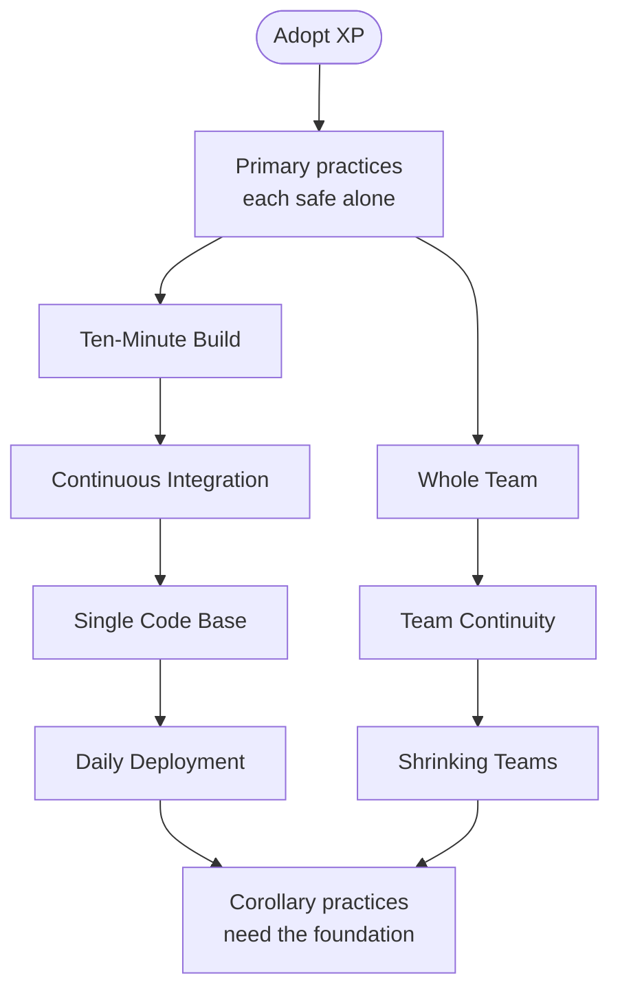

**Extreme Programming (XP)** is an [agile method](02-agile.md) that organizes a team around a fixed set of engineering practices rather than around a planning ceremony.

Kent Beck set it out in *Extreme Programming Explained: Embrace Change* (1999) and rewrote it substantially with Cynthia Andres for the second edition (2004).

The name comes from the method's construction rule: take a practice already known to help, and apply it at a level most teams would call excessive. Reviewing code helps, so XP reviews it continuously by having two people write it together. Restructuring code helps, so XP restructures a little every day instead of scheduling a redesign.

Where [Scrum](03-scrum.md) defines a container — roles, events, artifacts — and leaves the engineering to the team, XP prescribes the engineering and leaves the container mostly implicit. The two are often run together for that reason.

## Core Concepts

XP is built in three layers, and the second edition argues that all three are needed:

- A Value alone is unfalsifiable.
- A Practice alone is context-free, so it is easily copied without understanding (cargo-culted).
- Principles connect them.

Value
: Criterion a team judges its own behavior against, stated without reference to any situation and therefore never directly actionable

Principle
: Domain-specific bridging rule that turns a Value into a choice a team can make in a concrete situation

Practice
:   Behavior a team either performs or does not, observable from outside the team and therefore checkable

    - **Primary Practice** — safe to adopt on its own, before any other part of the method is in place
    - **Corollary Practice** — depends on several Primary Practices already working; difficult or dangerous to adopt first

A Practice in this sense is a *behavior*, not a recommendation. The evaluative sense — an approach accepted as superior for a given context — is defined as [Best Practice](index.md#core-concepts) in the chapter overview.

## The Five Values

| Value | What it means |
| --- | --- |
| **Communication** | When a problem appears, ask what communication would have prevented it and what communication resolves it now |
| **Simplicity** | Ask what the simplest thing is that could possibly work, then build that and no more |
| **Feedback** | Seek the shortest loop between a decision and evidence about it, because the sooner you know, the cheaper the correction |
| **Courage** | Act effectively in the face of fear — say the unwelcome thing, throw away the failing design; dangerous alone, useful with the other four |
| **Respect** | Care about the other members of the team and about the work itself; without it the other values are performances |

## The Fourteen Principles

| Principle | What it means |
| --- | --- |
| **Humanity** | People have needs — safety, accomplishment, belonging, growth — and a process that requires them to be permanently sacrificed will not be followed |
| **Economics** | Somebody pays for the work; a technical success that meets no business need is a hollow one |
| **Mutual Benefit** | Every activity should benefit everyone it touches, now and later — the hardest principle to hold to, and the one most often traded away |
| **Self-Similarity** | Copy the structure of a solution that works into a new context, including at a different scale |
| **Improvement** | In Beck's words, "'Perfect' is a verb, not an adjective": no process or design is ever finished, only made better |
| **Diversity** | Every team has conflict; a team with varied skills and perspectives has the raw material to resolve it productively |
| **Reflection** | Good teams think about how and why they are working, not only about the work |
| **Flow** | Deliver value in smaller increments, more often, rather than in phases |
| **Opportunity** | Treat each problem as an occasion to change how the team works, not merely something to survive |
| **Redundancy** | Overlapping practices catch the same defects by different routes; no single practice solves the defect problem |
| **Failure** | When you do not know what to do, failing teaches faster than talking — this excuses ignorance, not carelessness |
| **Quality** | Quality is not a control variable: raising it usually delivers sooner, and lowering it usually delivers later and less predictably |
| **Baby Steps** | Ask what the smallest step is that is recognizably in the right direction, because a reverted small step costs little |
| **Accepted Responsibility** | As Beck puts it, responsibility is something a person accepts, not something others assign — a task handed to someone who has not taken it on is still not theirs |

Mutual Benefit is the principle that most often decides whether a practice is worth adopting. Beck's own example is exhaustive internal documentation: one person suffers now so a hypothetical person benefits later, which fails the test. The same test applies to any artifact one person produces for another to consume.

## The 24 Practices

The second edition splits the practices into thirteen primary and eleven corollary. The split is an adoption order, not a ranking: primary practices are individually safe to start with, while corollary ones assume a foundation. The one-line summaries below are paraphrases.

### 13 Primary Practices

| Practice | What it is |
| --- | --- |
| **Sit Together** | Share one room that fits everyone, so questions and pairing need no appointment |
| **Whole Team** | Staff one team with every skill the work requires, so no task waits on another department |
| **Informative Workspace** | Put the live state of the work on the walls so that, as Beck puts it, a visitor can tell how the project is going within about fifteen seconds of walking in |
| **Energized Work** | Keep hours to a pace that stays productive week after week; tired people add defects faster than features |
| **[Pair Programming](../04-development-process/02-code-review.md#review-types)** | Two programmers share one screen for every line of production code, one typing while the other reviews |
| **Stories** | Plan in small slices a customer can see and value, each given a name and a rough estimate from the start |
| **Weekly Cycle** | Plan one week ahead, and open each week by checking what the previous one really delivered |
| **Quarterly Cycle** | Every three months, plan the next quarter and recheck the work against the larger goals |
| **Slack** | Keep a few optional items in every plan, so falling behind costs those items and not the promise |
| **Ten-Minute Build** | Keep the automated build and full test run under ten minutes, so people run it often instead of skipping it |
| **[Continuous Integration](../04-development-process/03-ci-cd.md)** | Merge each change into the shared code and test it within a couple of hours, before conflicts grow |
| **[Test-First Programming](../04-development-process/05-testing.md#test-driven-development-tdd)** | Start every code change with an automated test that fails until the change is made |
| **Incremental Design** | Improve the design a little every day, shaped to what the system needs now rather than to guesses about later |

### 11 Corollary Practices

| Practice | What it is |
| --- | --- |
| **Real Customer Involvement** | Bring the people whose work depends on the system onto the team, with part of its capacity theirs to direct |
| **Incremental Deployment** | Replace an old system piece by piece, moving real workload to the new one from early in the project |
| **Team Continuity** | Avoid breaking up teams that work well; much of their value is in how the members work together |
| **Shrinking Teams** | When a team gets more productive, keep its workload fixed and move people out to start new teams |
| **[Root-Cause Analysis](../04-development-process/04-quality-assurance.md#root-cause-analysis)** | For each defect that escapes development, fix both the defect and whatever allowed it through |
| **Shared Code** | No part of the code has a single owner; any team member may change it when it needs improving |
| **Code and Tests** | Treat code and tests as the only lasting artifacts; derive any other document from them |
| **[Single Code Base](../04-development-process/01-version-control.md#branch-lifetime)** | Keep one main line of code; short-lived branches are fine if they merge back within hours |
| **Daily Deployment** | Release to production at least once a day, so no change waits long to meet real use |
| **Negotiated Scope Contract** | Contracts hold time, cost, and quality fixed and treat scope as the variable, agreed step by step |
| **Pay-Per-Use** | Charge for use rather than per version or per upgrade, so revenue tracks the value actually delivered |

## How the Practices Have Held Up

XP's practices did not survive as a package. Some became industry defaults and stopped being credited to XP at all; others are still argued about.

The four groups below follow the split Anton Zaides made after rereading the book against current conditions, in [*Extreme Programming 1999→2026*](https://www.manager.dev/newsletter/extreme-programming-1999-2026) (Manager.dev, August 2026). The group names and the notes on each group are this book's. It is one practitioner's reading, not a measured result, but it fairly maps where the disagreement sits.

| Group | Practices | Why |
| --- | --- | --- |
| **Matter more now** | Whole Team, Team Continuity, Shrinking Teams, Energized Work, Real Customer Involvement | All five protect people. Frequent reorganizations, staffing plans that treat engineers as swappable units, and speed gains that become more work instead of shorter hours all push against them |
| **Disputed** | Pair Programming, Code and Tests, Incremental Design, Test-First Programming | Few reject the idea behind any of them; the dispute is over the absolute form of the rule — pairing on *all* production code, keeping *only* code and tests |
| **Now routine** | Single Code Base, Daily Deployment, Ten-Minute Build, Continuous Integration, Root-Cause Analysis, Negotiated Scope Contract, Shared Code | Standard practice in most teams, usually adopted with no link to XP in mind |
| **Changed in form** | Stories, Weekly Cycle, Quarterly Cycle, Slack, Incremental Deployment, Sit Together, Informative Workspace, Pay-Per-Use | The goal still holds, but the original form assumed one shared room and a slower pace; Sit Together and Informative Workspace need the most rework for distributed teams |

Two of the disputed four need precise statement, because they are the ones most often used to dismiss the whole method:

- **Pair Programming.** The objection is to *all*, not to pairing. Beck himself notes that most programmers cannot pair more than five or six hours a day — already a limit on the practice. A team that pairs on unfamiliar or high-risk work, but not on routine work, keeps the Feedback and Communication values and drops the absolute.
- **Code and Tests.** The objection is to *only*. The practice assumes social mechanisms carry project history, which fails on long-lived systems and on teams with turnover. The [Move Humans to the Left](05-move-humans-to-the-left.md) approach keeps the intent — no hand-maintained artifact that a machine could derive — without claiming that nothing but code and tests should exist.

XP's own principles are the right tool for judging a practice, including practices XP never named. Ask of any proposed way of working:

- **Mutual Benefit** — does everyone gain, or does one party absorb the cost so another gains?
- **Humanity** — does it respect people's needs, or does it assume people are elastic?
- **Quality** — does it treat quality as a control variable?

A practice that fails these tests will not hold, whatever its short-term numbers look like.

## Relationship to Other Methods

| Method | How it relates |
| --- | --- |
| **[Agile](02-agile.md)** | XP predates the 2001 Manifesto and Beck was a signatory; several Manifesto principles restate XP values |
| **[Scrum](03-scrum.md)** | Complementary — Scrum defines the container and leaves engineering practice open, which is the part XP specifies |
| **[Lean Software Development](01-lean.md)** | Shares the small-batch and fast-feedback reasoning; Lean argues it from flow economics, XP from defect cost |
| **[Technical Debt](../04-development-process/08-technical-debt.md)** | Incremental Design and Root-Cause Analysis are XP's answer to debt: pay it continuously rather than schedule repayment |

## References

- Kent Beck, *Extreme Programming Explained: Embrace Change*, 1st edition (Addison-Wesley, 1999)
- Kent Beck with Cynthia Andres, *Extreme Programming Explained: Embrace Change*, 2nd edition (Addison-Wesley, 2004) — the source of the five values, fourteen principles, and twenty-four practices above
- Anton Zaides, [Extreme Programming 1999→2026](https://www.manager.dev/newsletter/extreme-programming-1999-2026), Manager.dev, 18 August 2026 — the source of the four-group split in "How the Practices Have Held Up"
