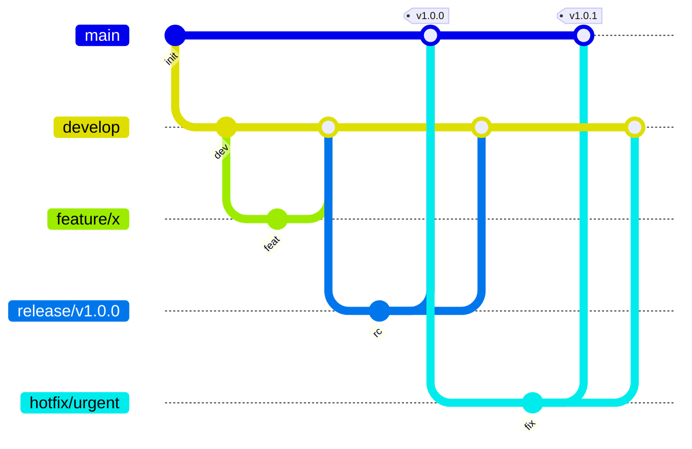

A version control system records every change to a codebase and lets a team work on it at the same time without overwriting each other's work. This guide covers what such a system does, how centralized and distributed systems differ, and how to choose a branching strategy.

## Version Control Systems

**Version control system (VCS)**: a system that tracks and controls changes to a document or codebase over time.

It gives a team three things:

- **History** — every saved state stays recoverable, so a bad change can be undone and lost files restored.
- **Accountability** — each change records its author, its time, and its reason.
- **Parallel work** — many developers change the same codebase at once, each in an isolated space; variants of the code live side by side as branches and are combined when ready.

Two components hold the code:

- **Repository** — shared storage for the reviewed and edited code
- **Working copy** — a developer's local copy, where edits are made

A developer **commits** finished edits from the working copy to the repository, and **updates** the working copy with the latest repository changes.

### Centralized Version Control

One shared repository holds the history. Developers keep local working copies, but others see their edits only after they upload them to that repository, so most operations need a connection to the server. Example: Team Foundation Version Control (TFVC).

### Distributed Version Control

Every developer's machine holds a full local repository, with the complete history, alongside the working copy. Two actions join commit and update:

- **Pull** — bring changes from the remote repository into the local repository and working copy
- **Push** — send committed local changes to the remote repository

Git is the most widely used distributed system.

### CVCS vs. DVCS

| Aspect | CVCS | DVCS |
| --- | --- | --- |
| **Focus** | Synchronizing and backing up files | Tracking and sharing changes |
| **Learning curve** | Easier to learn | Requires more practice |
| **Offline work** | Most operations need connectivity | Most work possible offline |
| **Resilience** | Losing the central server risks losing history | Every clone preserves the full history |
| **Configurability** | Simpler, more rigid | Flexible, more complex |

## Branching

**Branching**: copying code from the mainline so a developer can edit it without disrupting others' work.

| Term | Meaning |
| --- | --- |
| **Mainline** | The authoritative codebase, named `main` or `master`, that working copies are taken from |
| **Branch** | An isolated copy of the mainline, created for a change and expected to pass quality checks before it returns |
| **Merge** | Integration of a finished, tested branch back into the mainline |
| **Fork** | A branch that is not intended to be merged back |

A **merge conflict** happens when two branches change the same code in incompatible ways — for example, one developer edits lines that another deletes. One conflict is quick to resolve; many of them delay delivery. The branching strategy controls how often they occur.

### Branch Lifetime

How long a branch stays open shapes the cost of merging it more than any naming convention does.

**Long-lived branches** stay open for weeks and carry the full history of a feature's development. They suit complex work and distributed teams. But the longer a branch runs, the further it drifts from the mainline, and the larger the final merge and any rollback become.

**Short-lived branches** merge back within days. They suit [CI/CD](03-ci-cd.md) workflows and encourage small, frequent commits. The cost is more discipline around partly finished work, which usually means keeping it behind feature flags.

| Aspect | Long-Lived | Short-Lived |
| --- | --- | --- |
| **Merge size** | Larger, harder to review | Smaller, easier to review |
| **Rollback** | Harder, since more changes unwind together | Easier, since each merge carries less |
| **Merge conflicts** | More frequent and more demanding | Fewer and smaller |
| **Automation fit** | Integration is exercised late | Every merge exercises the pipeline |

### Branching Strategies

A branching strategy is the team's rule for when to create branches and when to merge them. The choice follows the release model: a team that ships on a fixed schedule and a team that deploys continuously need different rules.

| Strategy | Rule | Suits |
| --- | --- | --- |
| **GitFlow** | A fixed role per branch: `feature`, `develop`, `release`, `hotfix`, and `main` | Explicitly versioned software, or several versions supported at once |
| **Trunk-based development** | The whole team works from one shared trunk; branches, where used, are short-lived and merged back quickly | Continuous delivery, with review through small pull requests |
| **Feature isolation** | One branch per feature, held until the feature is ready to merge | Work that must be kept out of the mainline as a unit |
| **Release isolation** | A release branch is locked and accepts only critical hotfixes, while servicing branches carry patches for versions already released | Supporting software that is already in customers' hands |

Record the team's strategy where the whole team can find it — see [Knowledge Sharing](../10-humans/04-knowledge-sharing.md).

### GitFlow

GitFlow gives each branch a fixed role. In a 2020 note added to the [original post](https://nvie.com/posts/a-successful-git-branching-model/), its author, Vincent Driessen, suggests that teams practicing continuous delivery adopt a simpler workflow, such as GitHub flow, instead of forcing GitFlow onto it. He adds that GitFlow may still suit software that is explicitly versioned or must support several released versions at once.

| Branch | Purpose | Lifetime |
| --- | --- | --- |
| **`main`** | Production-ready code | Permanent |
| **`develop`** | Integration of finished features | Permanent |
| **`feature/*`** | New features | Until merged |
| **`release/*`** | Release preparation | Until released |
| **`hotfix/*`** | Urgent production fixes | Until merged |



```bash
# Start a new feature
git checkout develop && git checkout -b feature/new-feature

# Update with latest
git fetch origin && git rebase origin/develop

# Complete feature
git checkout develop
git merge --no-ff feature/new-feature
git branch -d feature/new-feature

# Create release
git checkout -b release/v1.0.0
git checkout main && git merge --no-ff release/v1.0.0
git tag -a v1.0.0 -m "Release v1.0.0"
git checkout develop && git merge --no-ff release/v1.0.0
```

## References

1. [A Successful Git Branching Model](https://nvie.com/posts/a-successful-git-branching-model/) — Vincent Driessen
2. [Git Cheat Sheet](https://devsheets.io/sheets/git) — DevSheets
