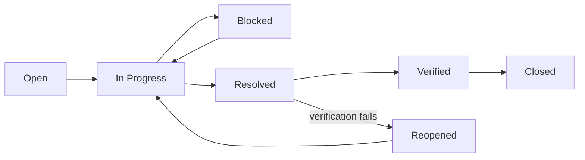

Quality assurance (QA) is the process, mostly run by test engineers, that gives confidence a product meets what customers and users expect. It costs time, money, and people, so its value must be argued to stakeholders, not assumed. This guide covers how QA is organized: its vocabulary, the life cycle it follows, test cases, defects, non-functional requirements, and metrics. The practices that carry it out — test principles, TDD, BDD, and unit testing — are in [Testing](05-testing.md), and the test automation strategy is in [Automated Testing](06-automated-testing.md).

## QA, Quality Control, and Testing

People use the three terms interchangeably, but in practice they mean different things.

Quality Assurance
: Process-level work spanning the whole lifecycle, aimed at stopping defects from being introduced at all

Quality Control
: Product-level work that inspects what was actually built and drives the issues it finds to resolution

Testing
: The activity of exercising a build to confirm it behaves as specified and carries no known faults

They nest rather than compete: testing is one activity inside quality control, and quality control is one activity inside quality assurance. This matters when a team says it "has QA" because someone runs tests before release — that is testing. The outer ring, designing the process so that fewer defects arrive at all, is the part most often missing.

On each project, quality must be pinned to attributes someone can evaluate: functionality, availability, performance, testability, security, usability, and reliability. Agreeing this list early makes everything below possible: test cases verify the first, and the [non-functional suites](#testing-of-non-functional-requirements) cover the rest.

### Error, Defect, and Failure

The terms follow the [ISTQB glossary](https://glossary.istqb.org/).

Error
: A mistake a person makes while writing code or interpreting a requirement

Defect
: Code that does not do what its specification says, whether or not anyone has run it yet; also called a bug

Failure
: The event a user sees when the running system cannot do what it was built to do

The three form a chain, and each link can break. An error becomes a defect only if it reaches the code; a defect becomes a failure only when something executes the affected path. So the counts never match, and zero failures in production says nothing about how many defects shipped.

## Testing Types and Methods

Every test sits at one point on each of three independent axes: who runs it, what it asserts, and how much of the internals the tester can see.

**Who runs it.** Manual and automated testing serve different needs; they do not compete for the same work.

| Approach | Strengths | Costs |
| --- | --- | --- |
| **Manual Testing** | Flexible — a person can follow a hunch, change course mid-session, and judge whether a result merely looks wrong | Slow, and the cost is paid again on every repetition, so it scales badly across a large regression suite |
| **Automated Testing** | Fast and repeatable, and the same suite can run on every commit for almost no marginal cost | Needs upfront investment in framework, environment, and ongoing maintenance before it returns anything |

**What it asserts.** Functional testing asks what the system does; non-functional testing asks how well it does it — see [Testing of Non-Functional Requirements](#testing-of-non-functional-requirements).

**What the tester sees.** The three box methods differ in the access the tester has, which decides what the tester can reason about.

| Method | What the Tester Sees | Typical Use |
| --- | --- | --- |
| **White Box** | The internal structure of the code under test | Verifying paths and branches, which is why it sits at the unit level |
| **Black Box** | Only the interface — inputs in, outputs out | Verifying behavior against the specification, with no assumption about how it is built |
| **Grey Box** | A hybrid: interface plus enough design and database access to construct inputs and confirm side effects | Integration and end-to-end work, where a result is only checkable by looking at stored state |

## Software Testing Life Cycle

The Software Testing Life Cycle (STLC) is the order of QA work, from reading a requirement to closing a release. A common breakdown has six phases.

| Phase | What Happens |
| --- | --- |
| **Requirement Analysis** | Testers read the requirements and decide which of them are testable and what would count as evidence |
| **Test Planning** | Scope, schedule, resources, and estimates are agreed and written down |
| **Test Case Design** | Cases are written, reviewed, and traced to the requirements they cover; test data is prepared |
| **Test Environment Setup** | The environment and tooling are made ready, independently of whether the cases are finished |
| **Test Execution** | Cases are run, results recorded, defects logged, and fixes retested |
| **Test Closure** | Results are reported, the suite is tidied, and what was learned is fed back into the next iteration |

The order shows dependencies; it is not a timetable. Environment setup usually runs in parallel with case design, and an iterative team repeats all six phases in every iteration, not once per project.

### Test Plan and Test Strategy

Planning produces two documents. Teams often merge them into one file and then lose track of which question each one answers.

Test Plan
: The document fixing scope, schedule, and resources — what gets verified and when

Test Strategy
: The document fixing the approach and the types of verification used — how the work gets done

The plan changes when the release changes; the strategy changes when the team changes how it works. Separate documents make it obvious which of the two happened.

### QA in the Iteration

QA fails quietly when it is treated as a final phase rather than as work planned alongside everything else. These practices keep it inside the iteration:

- **Keep one documented test process** — when each tester follows a private version, results cannot be compared across people or releases, and a new joiner inherits an oral tradition instead of a process.
- **Take part in planning, refinement, stand-up, and retrospective** — a tester in refinement can flag an untestable requirement while it is still cheap to reword; that is the earliest and cheapest defect any team catches.
- **Put test estimates into iteration planning** — unestimated work is not scheduled, and unscheduled testing is what gets squeezed when the iteration runs late.
- **Keep the Test Plan and Test Strategy current** — a plan not updated since project initiation stops being a reference and becomes something people work around.
- **Publish a test report every release** — the go/no-go decision needs evidence, and the report is the only record of what was and was not covered.
- **Verify non-functional requirements too** — they are the easiest to assume are someone else's job, and the most expensive to fix after release.

## Testing Pyramid

Layers, bottom to top: Unit → Integration → UI/E2E tests. Width is the number of tests; height is scope, complexity, and instability. The pyramid prescribes a shape, not a ratio: many fast unit tests, fewer integration tests, and a thin layer of end-to-end tests. The right proportion for a given system is a team decision, not a constant.

| Level | Speed · isolation | Purpose |
| --- | --- | --- |
| **Unit Tests** | Milliseconds · full | Component/function logic |
| **Integration Tests** | Seconds · partial | Component interactions |
| **E2E Tests** | Minutes · none | User journeys |

The principle underneath: verify everything at the lowest level that can verify it, and push a test down the pyramid whenever it can move. A lower test is faster, cheaper to maintain, and points at a smaller piece of code when it fails. It also keeps feedback short enough to run the unit suite on every code addition, where a failure is still cheap to fix.

### Unit vs. Integration Tests

A unit test runs in isolation, with every external dependency mocked or stubbed. It is fast, cheap, and precise: when it fails, it names the faulty code. An integration test uses the real dependency — a database, the network, a device. It is slower and costlier to run and maintain, and narrows a failure only to a module or component. The trade is diagnostic precision against realism, which is why both layers exist.

## Test Case Management

Test Case
: A single verification: one set of preconditions and inputs, and the one result they should produce

Test Suite
: A named group of cases run together for one purpose, such as a sanity, smoke, regression, UI, performance, or API run

Cases group into suites, and the [Test Plan](#test-plan-and-test-strategy) schedules the suites. A case is well formed when someone who did not write it can run it and reach the same verdict, and when it traces back to the requirement that justifies it. The fields serve that: ID, priority, title, description, steps, prerequisites, test data, expected result, requirement ID, environment, comments, defect ID, and automation status.

### Design Techniques

A case for every possible input is impossible, so these techniques choose which inputs deserve a case.

| Technique | What It Does |
| --- | --- |
| **Boundary Value Analysis** | Tests values at and immediately around the edges of an allowed range, where off-by-one mistakes live |
| **Equivalence Partitioning** | Divides the input space into classes whose members should be handled identically, then tests one member per class |
| **Decision Table Testing** | Enumerates combinations of conditions and the outcome each combination should produce, so no combination is left unconsidered |
| **State Transition Diagrams** | Model the states the system can be in and the legal moves between them, covering both the permitted transitions and the forbidden ones |
| **Use Case Testing** | Derives cases from end-to-end user flows, catching the gaps that appear only when steps are combined |
| **KISS** | Keeps each case to one simple verifiable thing, because a case that tests several things at once cannot report which of them broke |

### Test Case Life Cycle

A case is a maintained artifact, not a one-time write-up. Its life cycle: analyze the requirement → set up the environment and tools → write the case and self-review it → map it to the requirement it covers → peer review → automate it where that pays → execute → fold it into regression → retire it, or merge it with a duplicate. Teams skip the last step, and that is how a suite fills with cases that verify behavior the product no longer has.

Review happens at three levels, each further from the author: the author checks the case against the requirements document; a peer who did not write it checks it again; finally someone accountable for the whole suite, such as a senior tester, reviews it. They look for the recurring problems: missing coverage, spelling and grammar, non-standard templates, jargon a reader outside the team will not follow, duplication, and cases that have gone obsolete.

Coverage is tracked in a requirements traceability matrix, or a similar report that maps each requirement to its cases. It answers "which requirements have no case at all?" — a question no count of passing tests can answer.

### Regression Suites

A regression suite grows until running it costs more than the confidence it returns, so it needs curating: sort the cases into still reusable and now obsolete, prioritize what remains by business impact, and select for the run the cases that cover critical, frequently used, core, and recently changed functionality. Recently changed matters most: that code is where the next regression is.

**Practices:**

- Design each case as a discrete, verifiable action rather than a tour of the product.
- Keep cases in one specialized tool, so that coverage and results are countable.
- Prioritize and order regression execution, so a truncated run still covers the important cases.
- Organize cases into suites that match how they will be run.
- Trace every case to a requirement.
- Have the requirement owners review cases, since only they can say a case verifies the wrong thing.

## Defect Management

Defect management is a defect's path from being noticed to being reported on.

| Step | What Happens |
| --- | --- |
| **Discovery** | The defect is found and logged, by a tester, a developer, or a user |
| **Triage** | Priority and severity are set, and duplicates and change requests are filtered out |
| **Resolution** | The defect is fixed, and its root cause analyzed rather than only its symptom |
| **Verification** | A tester confirms the fix does what the report asked for |
| **Closure** | The defect is closed once verification passes |
| **Reporting** | What was found and fixed feeds the metrics below and the release report |

Triage protects the rest: a backlog that logs change requests as defects reports a defect count nobody can act on.

### Defect Life Cycle

The tracker shows this status flow; it exists mainly to make the reopen path visible:

### Priority and Severity

Two independent scales that measure different things:

- **Priority** is business urgency — Low, Medium, High, or Critical — and answers how soon this should be worked on.
- **Severity** is technical impact — Trivial, Minor, Major, Critical, or Blocker — and answers how badly the system is affected.

The two often conflict, which is why both exist. A typo in the company name on the landing page is trivial in severity but high in priority; a crash in a feature nobody uses yet is a blocker in severity but low in priority. A team that merges them into one field can express neither.

### Root Cause Analysis

Fixing a defect removes one symptom; root cause analysis stops the next one. Bring together the people who know the affected area, state the problem precisely, trace it to its cause, fix that cause, and add a check that would catch a repeat. Causes tend to fall into three groups: individual mistakes; unclear process, such as vague instructions or unclear task ownership; and failures of tools or infrastructure. Watch the middle group: it produces defects across unrelated parts of the product, and no amount of code review will find it.

### Production Defects

A production defect runs the same process under time pressure and in public. Work through it calmly: reproduce it, collect logs and reports, find the cause, tell the affected people when to expect a fix, verify the fix, then run root cause analysis so it does not recur. That last step weighs more than for an internal defect: this defect passed every filter the team has, so something in the process, not only in the code, failed.

**Metrics:** defect containment, the share of defects caught before release; the defect rejection ratio; the created-versus-resolved trend; and the backlog of known defects deferred to later releases, with the risk it carries. These sit alongside the wider set in [QA Metrics](#qa-metrics).

**Practices:**

- Log every defect in a tool built for defect tracking, not a spreadsheet or a chat, and link each defect to its user story.
- Define each severity and priority level and each workflow status in writing, so two people classify the same defect the same way.
- Resolve high and critical defects in the iteration that found them; do not carry them over.
- Hold regular triage meetings, and keep defects separate from change requests.
- Use one submission template, so every report arrives with the steps needed to reproduce it.
- Make root cause analysis and metrics reporting recurring commitments, not a response to a bad release.

## Testing of Non-Functional Requirements

Functional requirements say what the system does and are mandatory. Non-functional requirements say how well it does it — performance, usability, scalability, and the rest. They are often negotiable against time and cost, which is exactly why they are dropped first and are the most expensive to retrofit.

Non-functional testing has its own steps: plan, prepare, run, record the results, then analyze them and improve. The last two set it apart. A functional case ends in pass or fail; a non-functional run ends in a number that must be recorded and then judged against the agreed target, and that judgement is where the value is. A response time of 400 ms is neither a pass nor a failure until someone says what it should be.

Categories to agree with stakeholders: compatibility, performance, capacity, security, reliability and availability, scalability, maintainability, usability, and accessibility. Performance alone splits into load, endurance, volume, scalability, spike, and stress testing, each putting a different shape of demand on the system.

This work belongs inside the SDLC continuously, not in a block before release. In practice that means automating it: every category except usability and accessibility needs a tool, such as JMeter or LoadRunner, just to generate the load or conditions, and a pipeline can repeat a tool-driven run.

**Practices:**

- Test non-functional requirements every release, not once per project.
- Factor the results into the go/no-go release decision; that is what makes running them worthwhile.
- Automate them and run them in [CI/CD](03-ci-cd.md), so a regression in performance is caught the same way a regression in behavior is.
- Define quality attributes quantitatively wherever possible: "fast" cannot be tested, and "under 200 ms at the 95th percentile" can.

## QA Metrics

Metrics fall into two groups by what they can tell you.

Result Metrics
: Absolute counts of what happened — cases passed, failed, or blocked, defects found, accepted, or rejected, planned against actual hours, post-release bugs

Predictive Metrics
: Ratios derived from those counts that flag risk early, such as defect containment efficiency, defect leakage, the defect reopen ratio, the rejection rate, and test design efficiency

Counts describe the release that just happened; ratios let a team act before the next one goes the same way. A rising reopen ratio says fixes are not verified properly — while there is still time to change how they are verified.

Metrics work as a cycle: pick metrics that answer a question someone actually has, agree with the team which data to capture, automate the collection, and report against the agreed targets, dropping targets that no longer change a decision. The improvement loop around it is PDCA (Plan, Do, Check, Act), which turns a number that moved into a change in how the team works.

**Practices:**

- Measure on a defined, automated schedule, so the numbers are comparable between releases.
- Turn every result into a concrete action; a metric nobody acts on costs collection effort and returns nothing.
