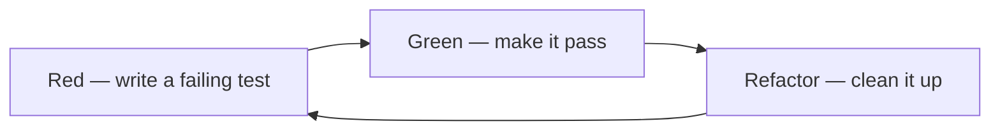

This guide covers how to write tests: the principles a good test follows, the two test-first disciplines, unit testing, the vocabulary of test doubles, what a coverage number proves, and where suites run in a pipeline. How testing is organized and reported — test case management, defect management, non-functional testing, and metrics — is in [Quality Assurance](04-quality-assurance.md), and the automation strategy is in [Automated Testing](06-automated-testing.md).

## Testing Principles (F.I.R.S.T.)

The acronym comes from Brett Schuchert and Tim Ottinger ([Agile in a Flash](https://agileinaflash.blogspot.com/2009/02/first.html)) and appeared in Robert C. Martin's *Clean Code*.

Fast
: Runs in milliseconds, so the whole suite can run on every change without anyone waiting for it

Independent
: Shares no state with any other test, and sets up and tears down whatever it needs

Repeatable
: Produces the same result on every run, on any machine, in any order

Self-Validating
: Reports its own pass or fail, with no human reading output to decide which it was

Timely
: Written alongside the code it covers, in the same change or ahead of it under TDD

**Practices:**

- Test behavior, not implementation details
- Use descriptive names: `it('returns correct total when items are added')`
- Follow Arrange → Act → Assert
- One assertion per test where possible
- Mock external dependencies (APIs, databases, file system)

## Test-Driven Development (TDD)

Write a failing test first, make it pass with the simplest code that works, then improve the design. The test defines the contract before the implementation exists, so the code is testable by construction, and no line ships without a test that was *seen* to fail.



| Step | Goal | Rule |
| --- | --- | --- |
| **Red** | Write the smallest test that expresses the next behavior | Run it and watch it fail — a test that never failed proves nothing |
| **Green** | Make it pass as directly as possible | No speculative features; duplication is acceptable at this step |
| **Refactor** | Improve naming, structure, and duplication | Tests stay green; no new behavior is added |

**Red** — the test fails because `total()` does not exist yet:

```ts
it('returns the total of all items in the cart', () => {
  const cart = createCart();
  cart.addItem({ id: 'sku-1', price: 10, quantity: 2 });
  expect(cart.total()).toBe(20);
});
```

**Green** — the simplest code that satisfies the test:

```ts
export const createCart = () => {
  const items: CartItem[] = [];
  return {
    addItem: (item: CartItem) => items.push(item),
    total: () => items.reduce((sum, i) => sum + i.price * i.quantity, 0),
  };
};
```

**Refactor** — extract, rename, and remove duplication once the test protects you.

**Practices:**

- Keep cycles short — minutes, not hours; a long red phase means the step was too big
- Let the test drive the API: if a test is awkward to write, the design is awkward to use
- Add a failing test for every bug before fixing it, so regressions stay caught
- Refactor only on green, and never mix a refactor with a behavior change
- Assert on observable behavior so refactoring does not break the suite

**Trade-offs:** TDD pays off most on logic with real branching — pricing, validation, state machines, reducers. It pays off least on exploratory spikes and purely visual markup, where the design is not yet stable enough for a test to pin down.

TDD and BDD are complements, not alternatives: BDD frames *what* the system should do for the user, TDD drives *how* each unit is built to get there.

## Behavior-Driven Development (BDD)

BDD describes expected behavior from the user's perspective, in natural language.

```gherkin
Feature: User Login

Scenario: Successful login with valid credentials
    Given the user is on the login page
    When the user enters valid email "user@example.com"
    And the user enters valid password "password123"
    And clicks the login button
    Then the user is redirected to the dashboard

Scenario: Failed login
    Given the user is on the login page
    When the user enters invalid credentials
    Then the user sees an error message
```

## Unit Testing

A unit test is code that asserts one or more conditions to verify another piece of code behaves as expected, in isolation, without running the full application.

### Why It Matters

- **Maintainability** — the ability to change, understand, and test code without fear. Unit tests support all three: they state what the code should do, they fail when a change breaks it, and they force the code into a shape that can run on its own.
- **The cost of change over time** — early in a project, coding without tests really is faster: there is little code to break, and the whole design fits in one person's head. As the codebase grows, changing untested code costs more and more — every change means re-reading more code and risking something nobody remembers — while the cost of a suite stays roughly proportional to the code it covers. The two effort curves are usually said to cross, after which the tests pay for themselves. Treat the crossover as a model of how the costs behave, not a measured date: nobody can name the week a given project reaches it. The decision rests on the direction: the longer code lives, the worse the untested option gets.
- **Confidence to change code** — a suite is a contract that records today's behavior, so a refactor that keeps the tests green left the behavior alone. Without that contract, restructuring is a gamble; people stop taking it, and the codebase hardens.
- **A record of the edge cases** — tests document the branches and boundary conditions nobody remembers months later, so that knowledge survives in the suite rather than in the original author.
- **Pressure on the design** — code that is awkward to test is usually awkward to use, so writing the test exposes hidden dependencies and overly wide interfaces while they are still cheap to change.
- **Evidence of what they catch** — Yuan et al. (OSDI '14) sampled 198 user-reported failures across five distributed data-intensive systems and found 77% of them reproducible by a unit test. The finding is about that class of system, not about production failures in general, but it sets a high bar for what unit tests can catch.
- **The cost of skipping** — "To me, legacy code is simply code without tests" (Michael Feathers, *Working Effectively with Legacy Code*, 2004, Preface). Untested code starts earning that status the day it is written, because the next person to touch it cannot change it safely.

This book's convention — a convention, not a finding — is to skip unit tests only for code with a known disposal date: throwaway proofs of concept and demos that answer one question and are deleted once it is answered. Deciding by expected project length invites exactly the failure described above: the estimate comes before anyone knows whether the code will survive, and short-lived code that proves useful is precisely the code that becomes untested legacy. If the code will be maintained, the exception does not apply.

### Qualities of a Good Unit Test

- **Maintainable** — test code meets the same quality bar as production code, because people ignore or delete an unreadable suite the first time it goes red for an unclear reason.
- **Isolated** — a test that reaches a database, the filesystem, the network, or environment config fails for reasons unrelated to the code under test, and every such failure teaches the team to distrust the suite.
- **Properly targeted** — cover the domain logic, where the branching and the risk actually live; tests over trivial or incidental code cost maintenance and prove nothing.

### Misconceptions About Unit Tests

| Misconception | What Is Actually True |
| --- | --- |
| **Legacy code cannot be unit tested** | It can, a piece at a time: add a seam, write a test that records today's behavior, then refactor behind that test. The obstacle is effort, not possibility |
| **Unit tests are too expensive** | They move cost earlier rather than add it. In a 2008 study of four industrial teams at Microsoft and IBM that adopted TDD, Nagappan, Maximilien, Bhat and Williams reported 40–90% lower defect density for 15–35% more initial development time |
| **There is no time for tests when production is urgent** | Urgency is the strongest case for them: when a regression pass will not fit, a suite that runs in seconds is often the only safety net that does |
| **Tests can come after the code** | Tests added late, like input validation added late, mean reopening code that has already shipped; the time saved now is paid back later, from the same schedule |
| **Test code matters less than production code** | The quality of the tests limits how maintainable the production code is: a slow, flaky or unreadable suite stops being run, and the code it covered is then untested in practice |

In practice: write the tests in the same task or story as the production code, not in a later phase; hold them to the [F.I.R.S.T. principles](#testing-principles-first) above; and run them where they can stop a bad change. See [Running Tests in CI](#running-tests-in-ci) for where a suite sits in a pipeline, and [Coverage Types](#coverage-types) for what a coverage number does and does not prove.

## Test Doubles

The five kinds below are Gerard Meszaros's taxonomy from *xUnit Test Patterns*. In practice the names are used loosely, and most mocking libraries produce whichever kind you configure, but the distinctions make a test's intent readable.

Test Double
: Any stand-in a test substitutes for a real collaborator so the code under test can run in isolation

Dummy
: A value passed only to satisfy a signature, never called and never asserted on

Fake
: A working implementation that takes a shortcut making it unfit for production, such as an in-memory store standing in for a database

Stub
: A double that returns canned answers to the calls a test makes, supplying the input the code needs to reach the case under test

Spy
: A double that records the calls it receives so the test can assert on them afterwards

Mock
: A double preloaded with the calls it expects to receive, which fails the test itself when the code does not call it that way

The important line is between the last three. A stub is about input: it feeds the code what it needs to reach the case under test, and asserts nothing. A mock is about verifying interaction: it expects to be called in a certain way and fails the test when that expectation is not met. A spy sits between them: it records calls without judging them, so the assertion stays in the test, where a reader can see it.

Use a stub whenever the collaborator is only a source of data, and a mock only when the call itself is the behavior under test — sending the email, publishing the event. Mocking incidental calls couples the test to the implementation and breaks it on every refactor.

## Coverage Types

Coverage tools report one percentage by default; which of these it measures changes what the number proves.

Statement Coverage
: Share of executable statements the suite ran at least once

Line Coverage
: Share of source lines executed; differs from statements only where one line holds several of them

Branch Coverage
: Share of decision outcomes taken, so an `if` counts only once both the true and the false path have run

Function Coverage
: Share of functions or methods entered at least once, the coarsest of the four

Branch coverage catches an untested `else`. Statement and line coverage can read 100% while a conditional only ever runs one way, because every statement did run — just never with the other outcome. Function coverage is weaker still: it says a function was entered, not that anything inside it was checked.

None of them measures verification. A suite with 99% coverage and no assertions proves nothing, so 100% is not a quality guarantee. Track the number as a macro trend and to spot untested areas, and no further. See [QA Metrics](04-quality-assurance.md#qa-metrics) for how it sits among the other measures a team reports.

## Running Tests in CI

Where a suite runs decides what it can be trusted to do. The pipeline stages are in [CI/CD](03-ci-cd.md); this section covers the testing side.

- **Gating suites** run on every push and must be fast — unit tests plus a thin smoke layer. A gate slower than a few minutes becomes a queue, and people start working around it.
- **Scheduled suites** run nightly or on a cron — full regression, long-running integration, performance and load runs. They cover what a gate cannot afford to wait for, at the price of a slower feedback loop.
- **A flaky test in a gating suite is worse than no test.** It trains everyone to hit re-run instead of reading the failure, and once that reflex exists a genuine failure gets re-run too. Quarantine a flaky test out of the gate the day it is spotted, then fix or delete it.
- **The result needs to be a machine-readable artifact**, not only lines in the log. A structured report the pipeline can parse — JUnit XML is the usual interchange format — lets the build annotate the failing case, track flakiness across runs, and enforce a coverage threshold without a human reading output.
