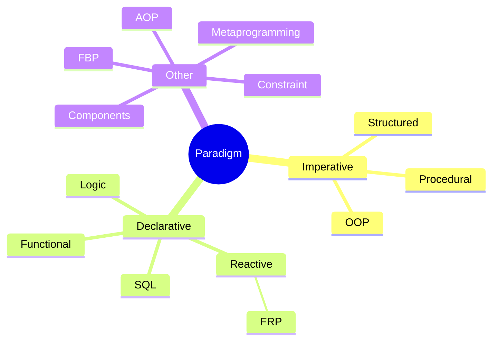
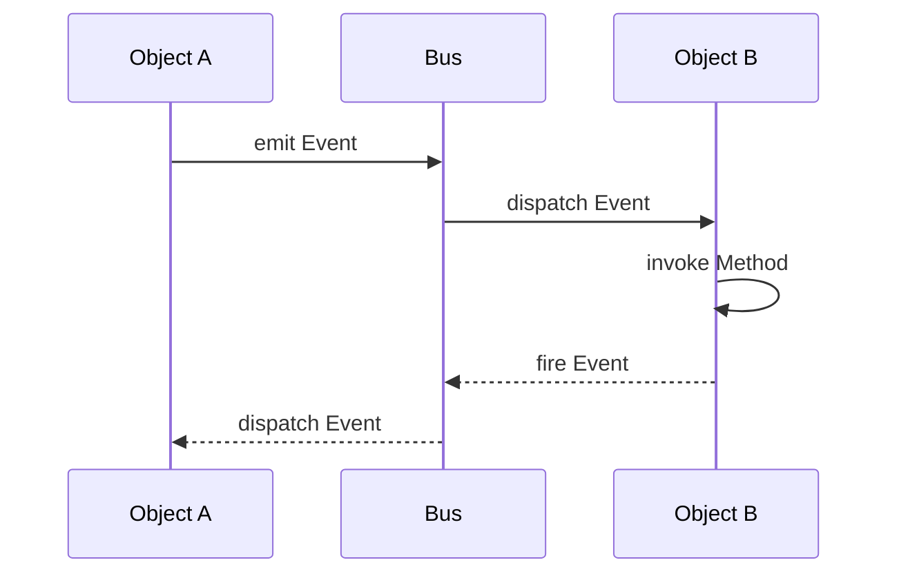

A **programming paradigm** is an opinionated view of what computation is. It dictates how data and code are organized, accessed, and changed. This guide surveys the imperative, object-oriented, declarative, and functional families, for engineers choosing a style for a component or reading code written in an unfamiliar one. It is also the canonical home for the OOP pillars. The reactive family has its own guide, [Reactive Programming and FRP](02-reactive-programming.md), and so do metaprogramming and AOP, in [Metaprogramming and AOP](03-metaprogramming.md).

## Imperative Programming

| Paradigm | Description |
| ---------- | ------------- |
| **Imperative** | An early approach: a program is a sequence of commands, each updating the program's state in place. Values change by assignment, and many parts of the code may read and write the same data |
| **Structured** | Imperative code built only from sequence, choice, and loops, so control flow is easy to follow. Code is grouped into nested blocks; jumps such as `goto` are rare or absent |
| **Procedural** | Structured code organized into named procedures that call one another and pass data through parameters |

## Object-Oriented Programming (OOP)

A prominent approach that treats computation as a side effect of stateful objects interacting over their lifecycle.

### OOP Pillars

| Principle | Description |
| ----------- | ------------- |
| **Abstraction** | Representing a real object by only the properties that matter to the problem |
| **Encapsulation** | Mechanism that blocks outside access to an object's state, hiding internal complexity |
| **Inheritance** | Mechanism that lets one class borrow or extend state and behavior from a base class |
| **Polymorphism** | Mechanism that lets descendants override method implementations while keeping signatures and semantics |

For language-agnostic design heuristics such as SOLID, GRASP, and DRY, see [Design Principles](04-design-principles.md).

### OOP Concepts

Object
: A single instance in program code with its own State and Behavior

Class
: Specification of State and Behavior used to create new Objects

Model
: Bundle of interdependent Classes that a system consists of

State
: Internal data structure private to one instance

Behavior
: Set of Methods implementing logic over the State they share

Method
: Named way of handling one specific input message

Implementation
: Code defining how an input message is actually handled; reads input and State, and may update State, produce results, or send further messages

Invocation
: Act of performing the instructions of a Method with given arguments, scope, and context

Interaction
: Process of sending messages between Objects, each answered by Invocation of the matching Method

Event-Driven Flow
: Indirect Interaction in which uniform events travel through a centralized dispatcher (bus)

## Declarative Programming

A style in which a program states the result it wants and leaves the steps to the runtime, so control flow does not appear in the code. Many declarative languages limit or remove side effects, so a program reads as a description of WHAT, not HOW.

Examples: query languages such as SQL; logic languages such as Prolog and Datalog; regular expressions; markup for user interfaces such as HTML, XAML, and MXML; and XSLT for transforming XML.

## Functional Programming

A paradigm that treats computation as the declarative composition of pure (mathematical) functions.

### Functions and Purity

Operation
: Correspondence of input with unambiguous output: (x..., y1) & (x..., y2) => y1 ≡ y2

Parameter
: Reference to an elementary piece of the input data structure, by name or index

Argument
: Input data value applied to the corresponding Parameter when an Operation is performed

Function
: Operation mapping elements of a domain to elements of a codomain

Arity
: Dimension of the domain space: unary, binary, n-ary, variadic

Partial Function
: Mapping not defined for every value of its domain

Deterministic Function
: Mapping that always produces the same result for the same input

Pure Function
: Deterministic Function without side effects

Side Effects
: Interactions (reads or writes) with external mutable state

Higher-Order Function (HOF)
: Function that takes a function as argument, returns a function, or both

Immutability
: Inability to destructively change input parameters, context, or state

Idempotent
: Property of an operation whose reapplication to its own result changes nothing; see [System Design Glossary](../03-system-design/01-common-concepts.md)

### Function Composition

Function Pipe
: Chain of functions in which each output is the input of the next

Fun-Arg Problem
: Difficulty of keeping a function's free variables alive after the scope that defined them has returned

Closure
: Function retaining a reference to its free variables from the outer scope

Point-Free Style
: Defining functions without naming the arguments they use

Partial Application
: Creating a new function by pre-filling some arguments of the original

Currying
: Transformation of an n-ary function into a chain of unary functions, each taking one Argument

Auto Currying
: Transforming a multi-argument function so that, given fewer arguments, it returns a function taking the rest

Fixed-point Combinator
: Function Y returning the fixed point of its argument function: Y(f) == f(Y(f))

### Evaluation Strategy

Evaluation order is independent of the paradigm: Haskell is lazy by default, while Standard ML, OCaml, Scheme, Clojure, and Erlang are strict.

Lazy Evaluation
: Call-by-need strategy that defers computing an expression until its value is demanded, allowing infinite data structures

Continuation
: The part of code yet to be executed at any given point

Memoization
: Cache of previously computed results, reused instead of recomputing

Recursion
: Function calling itself during execution

Tail Recursion
: Recursion whose recursive call is the last step of the function, so a compiler that eliminates tail calls can run it as a loop

## Other Paradigms

The families above, together with [Reactive Programming and FRP](02-reactive-programming.md) and [Metaprogramming and AOP](03-metaprogramming.md), cover most production code. Engineers still meet the paradigms below, usually as a specialized language or framework inside an otherwise conventional system. Each is described by the unit it treats as primitive, because that choice is what separates it from the paradigms covered above.

Logic Programming
: Declarative style where a program is a set of facts and rules, and running it asks the engine to search for a proof of a goal instead of prescribing the steps (Prolog, Datalog, answer-set solvers)

Constraint Programming
: Close relative of Logic Programming: the program states relations a solution must satisfy and a solver explores the feasible space, so the search strategy belongs to the engine, not the author (MiniZinc, Choco, OR-Tools)

Flow-Based Programming (FBP)
: Assembly of black-box processes that exchange fixed-format packets over bounded, named connections owned by the network rather than by any process, which makes the topology data instead of code (NoFlo, Node-RED, LabVIEW)

Agent-Oriented Programming
: Autonomous entities holding their own beliefs, goals, and plans as first-class program elements and coordinating through messages instead of direct invocation, so control is truly decentralized (JADE, Jason/AgentSpeak)

Component-Based Software Engineering
: Building systems from independently deployable units that expose only contractual interfaces, which moves substitution and reuse from the Class boundary out to the packaging boundary (OSGi, COM, .NET assemblies)

Modular Programming
: Splitting a program into separately compiled units with explicit exported and imported names — the discipline Procedural programming grew out of, and the one that today's packages and namespaces still implement (Modula-2, ML functors, JPMS, ES imports)

Three names once in this list are left out on purpose, because they are not paradigms:

- **SQL** is a language; it appears above as an example of [Declarative Programming](#declarative-programming).
- **Domain-Driven Design** is a modeling and design approach, not a view of what computation is; its tactical patterns belong with [Design Patterns](05-design-patterns.md).
- **"Mathematical model"** names no paradigm at all; the idea behind it, computation as the evaluation of pure functions, is [Functional Programming](#functional-programming).
