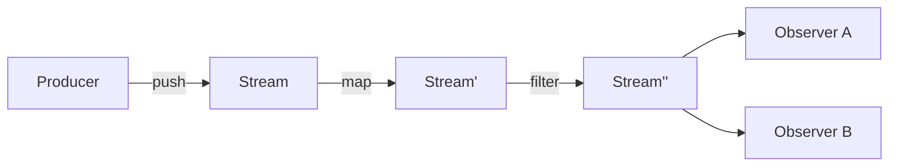

This guide continues [Programming Paradigms](01-programming-paradigms.md) with the reactive family: programs that react to data streams, and the functional formulation of the same ideas.

## Reactive Programming

Programming as defining reactions to data streams: sequences of incoming events that can be combined and observed asynchronously.

Control is inverted. Instead of the consumer asking for the next value (pull), the producer pushes values to whoever declared interest, and change propagates automatically through the dependency graph.

### Stream Concepts

Stream (Observable)
: Time-ordered sequence of values, plus terminal completion or error signals

Observer (Subscriber)
: Consumer declaring handlers for the three channels: `next`, `error`, `complete`

Subscription
: The live link between producer and consumer; must be disposed to stop the flow and free resources

Push vs. Pull
: Which side sets the pace: a source emitting on its own schedule, or a consumer requesting the next value (iterators, generators)

Cold vs. Hot
: Whether each subscriber triggers its own execution from the beginning, or joins one already-running sequence shared by all

Subject
: Object that is both observer and observable — the usual bridge from imperative code into a stream

Propagation of Changes
: Automatic recomputation of every value derived from a source when that source updates

Glitch
: Transient inconsistent state where a dependent observes partially updated inputs

Backpressure
: Protocol for a slow consumer to limit a fast producer (request-n, buffer, drop, sample, or block)

Scheduler
: Policy deciding on which thread or tick emissions and subscriptions run

### Operator Categories

| Category | Examples | Purpose |
| ---------- | ---------- | --------- |
| **Creation** | `of`, `from`, `interval`, `fromEvent` | Turn values, collections, timers, or callbacks into streams |
| **Transformation** | `map`, `scan`, `pluck` | Reshape each value or accumulate over the sequence |
| **Filtering** | `filter`, `take`, `skip`, `distinctUntilChanged` | Drop values that should not reach the consumer |
| **Combination** | `merge`, `concat`, `zip`, `combineLatest`, `withLatestFrom` | Join several streams into one |
| **Flattening** | `switchMap`, `mergeMap`, `concatMap`, `exhaustMap` | Handle inner streams; differ in what happens to overlapping ones |
| **Timing** | `debounce`, `throttle`, `sample`, `buffer`, `delay` | Control emission rate and alignment in time |
| **Error Handling** | `catchError`, `retry`, `timeout` | Recover from or bound failures without breaking the pipeline |
| **Multicasting** | `share`, `publish`, `refCount` | Convert cold to hot, sharing one execution among subscribers |

### Rate Control

| Technique | Behavior |
| ----------- | ---------- |
| **Throttle** | Emit the first value, then ignore the rest for a fixed window (rate limiting) |
| **Debounce** | Emit only after a quiet period — the last value of a burst wins (search-as-you-type) |
| **Sample** | Emit the latest value at a fixed clock, regardless of source rate (polling a signal) |
| **Buffer / Window** | Batch values into arrays or sub-streams by count or time |

### Reactive Systems

The *Reactive Manifesto* applies the same idea at architecture scale:

| Trait | Meaning |
| ------- | --------- |
| **Responsive** | Answers in a predictable time |
| **Resilient** | Stays responsive under failure via isolation and replication |
| **Elastic** | Stays responsive under varying load by scaling resources |
| **Message-Driven** | Built on asynchronous, non-blocking message passing with explicit boundaries |

*Implementations*: RxJS/RxJava/Rx.NET, Project Reactor, Akka Streams, Kafka Streams, Reactive Streams (`java.util.concurrent.Flow`, added in Java 9)

*See also*: [Functional Reactive Programming](#functional-reactive-programming-frp) — the pure-function, time-explicit formulation of these ideas

## Functional Reactive Programming (FRP)

A combination of the functional and reactive paradigms. Values that change over time are first-class and are transformed by pure functions, instead of being updated by callbacks that mutate shared state.

### FRP Concepts

Behavior (Signal)
: Value continuously defined over time: `Behavior a = Time -> a`

Event Stream
: Discrete sequence of timestamped occurrences: `Event a = [(Time, a)]`

Declarative Time
: Time as an explicit input of the model, not an implicit side effect of execution order

Combinator
: Pure HOF building new behaviors or streams from existing ones (`map`, `filter`, `merge`, `scan`, `switch`)

Lifting
: Applying an ordinary function to time-varying values, producing a time-varying result

Sampling
: Reading a behavior's value at the moments given by an event stream

Accumulation (`scan`/`fold`)
: Deriving state from a stream by folding past occurrences — the only sanctioned form of state

Glitch-Freedom
: Guarantee that dependents observe a consistent snapshot; no intermediate values from partial propagation

### Variants

| Variant | Description |
| --------- | ------------- |
| **Classical FRP** | Continuous behaviors + discrete events with denotational semantics (Fran, Reactive) |
| **Arrowized FRP** | Signal functions (`Signal a -> Signal b`) composed as arrows, avoiding space/time leaks (Yampa) |
| **Discrete / "RX-style"** | Push-based streams without continuous time; pragmatic and widely deployed (RxJS, Reactor, Combine) |
| **Signal-based UI** | Fine-grained dependency graph of signals with automatic recomputation (SolidJS, Svelte runes, Angular signals) |

### FRP Trade-offs

| Aspect | Note |
| -------- | ------ |
| **Strengths** | Explicit data flow, composability, no manual subscription bookkeeping, testable as pure transformations |
| **Costs** | Steep learning curve, hard debugging (stack traces lost in the graph), memory/space leaks from retained histories |
| **Applicability** | UI state, animation, telemetry, event processing, robotics, and simulation |

*See also*: [Functional Programming](01-programming-paradigms.md#functional-programming) for the concepts used here, such as HOF · [Metaprogramming and AOP](03-metaprogramming.md)
