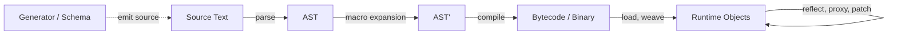

This guide continues [Programming Paradigms](01-programming-paradigms.md) with programs that treat code as data, and with aspect-oriented programming, which is built on them.

## Metaprogramming

Writing programs that treat other programs, or themselves, as data: reading, generating, or transforming code instead of only executing it. The *metaprogram* operates on the *object program*; **when** the transformation happens fixes the boundary between them.

### Metaprogramming Concepts

Metalevel vs. Base Level
: The metaprogram manipulates representations of code; the object program is the code being manipulated

Introspection
: Read-only examination of program structure — types, members, signatures, annotations

Reflection
: Introspection plus *intercession*: invoking, defining, or altering structure dynamically

Homoiconicity
: Code is represented in the language's own data structures, so manipulating code is ordinary data manipulation (Lisp s-expressions)

AST
: Tree representation of parsed source; the usual currency of compile-time transformation

Quoting / Quasiquotation
: Turning code into data (`quote`), with holes for splicing computed fragments back in (`unquote`)

Macro
: Function from code to code, expanded before evaluation rather than called at runtime

Hygiene
: Guarantee that names introduced by a macro cannot capture or collide with names at the call site

Staging
: Explicit separation of computation into phases — what runs now to produce what runs later

Code Generation
: Emitting source, bytecode, or binaries from a model, schema, or IDL

Eval
: Evaluating data (a string, an AST) as code inside the running program

DSL
: Purpose-built notation, *internal* (hosted in the language) or *external* (own parser)

### Stages

The same goal can be reached at different points in the lifecycle, with very different trade-offs.

| Stage | Mechanisms | Character |
| ------- | ------------ | ----------- |
| **Compile-time** | Macros, templates, `comptime`/`constexpr`, annotation processors, source generators | No runtime cost, type-checkable, visible to tooling; errors surface as expansion failures |
| **Load / Link-time** | Bytecode weaving, custom class loaders, generated proxies, instrumentation agents | Applies to code you do not own; invisible in source, so behavior diverges from what is read |
| **Run-time** | Reflection, dynamic proxies, `eval`, metaclasses, method interception | Maximum flexibility and late binding; costs performance and defeats static analysis |

### Techniques

| Technique | Mechanism | Examples |
| ----------- | ----------- | ---------- |
| **Textual Macros** | Token substitution before parsing; unhygienic, unaware of syntax | C/C++ preprocessor |
| **Syntactic Macros** | AST-to-AST functions run by the compiler; hygiene depends on the macro system | Scheme `syntax-rules`/`syntax-case` (hygienic), Common Lisp `defmacro` (unhygienic, hence `gensym`), Rust `macro_rules!` and proc macros, Scala 3 `inline`/quotes, Elixir |
| **Compile-time Evaluation** | Ordinary code executed by the compiler to specialize or produce declarations | C++ templates and `constexpr`, Zig `comptime`, D CTFE |
| **Annotation Processing** | Declarative metadata read by a generator that emits companion code | Java APT/Lombok, Kotlin KSP, C# Source Generators, `go:generate` |
| **Reflection APIs** | Runtime access to the type system and member tables | `java.lang.reflect`, `System.Reflection`, Python `inspect`/`getattr`, JS `Reflect` |
| **Proxies & Interception** | Synthesized objects forwarding calls through a handler | JDK dynamic proxies, ByteBuddy/CGLIB, JS `Proxy` traps, Python `__getattr__` |
| **Metaclasses & Open Classes** | Controlling or rewriting class construction and dispatch | Python `type`/`__init_subclass__`, Ruby `class << self` and monkey patching, and JS decorators |
| **Bytecode Manipulation** | Rewriting compiled artifacts directly | ASM, Javassist, ByteBuddy, Mono.Cecil |
| **Schema-driven Generation** | Deriving clients, models, and serializers from an external contract | Protobuf/gRPC, OpenAPI, GraphQL codegen, ORM entities |

### Metaprogramming Trade-offs

| Aspect | Note |
| -------- | ------ |
| **Strengths** | Removes boilerplate and duplication, enforces cross-cutting concerns in one place, adapts to schemas and types unknown when the code was written, enables DSLs closer to the domain |
| **Costs** | Code that is read is no longer the code that runs — debugging, stack traces, IDE navigation, and refactoring all degrade; reflection and `eval` block dead-code elimination, AOT compilation, and security review; expansion errors are reported in generated code |
| **Applicability** | Serialization, ORM and DI wiring, mocking and test doubles, AOP concerns (logging, transactions, retries), builders and derived boilerplate, and API clients from contracts |

*Guidance*: prefer the earliest stage that solves the problem — a generic or template before a macro, a macro before an annotation processor, an annotation processor before runtime reflection. Use the dynamic option only when the shape of the code is truly unknown until execution.

*See also*: [Aspect-Oriented Programming (AOP)](#aspect-oriented-programming-aop) — its join points, advice, and weaving are built almost entirely on the load-time and run-time stages above.

## Aspect-Oriented Programming (AOP)

Some requirements — logging, transactions, retries, authorization, tracing — cannot be localized in any single Class or Function. They cut across many, so the dominant decomposition repeats the same lines at every call site and tangles them with the core logic. AOP makes the scattered requirement itself a first-class unit: defined once, and attached where it applies by a declarative rule instead of an explicit call.

Cross-Cutting Concern
: Requirement whose implementation would otherwise be scattered across many unrelated units and tangled with their primary logic

Join Point
: Well-defined moment in program execution where extra behavior may be attached: a method call or execution, a field access, an exception being thrown

Pointcut
: Predicate selecting a set of Join Points by signature, annotation, or type hierarchy, so the targets are described rather than enumerated

Advice
: Code to run at the selected moments, ordered relative to them as `before`, `after`, `after throwing`, or `around` — the last wrapping the target and free to skip or replace it

Aspect
: Unit bundling one or more Pointcuts with their Advice and any state they share, playing the role a class plays in OOP

Weaving
: Act of merging that extra behavior into the target program, done at compile time, at load time, or at run time through generated proxies

Introduction
: Adding members or a supertype to an existing class from outside its own definition, also called an inter-type declaration

*Implementations*: AspectJ (compile-time and load-time weaving), Spring AOP (runtime proxies, limited to method execution on managed beans), PostSharp, and the interceptor chains of most DI containers.

The trade-off is the one [Metaprogramming](#metaprogramming) always carries: an Aspect applies with no mark at the call site, so the code that is read is no longer the code that runs. Reserve AOP for concerns that are truly uniform across many units, and keep Pointcuts narrow enough that a reader can predict where they fire.

*See also*: [Programming Paradigms](01-programming-paradigms.md) · [Reactive Programming and FRP](02-reactive-programming.md)
