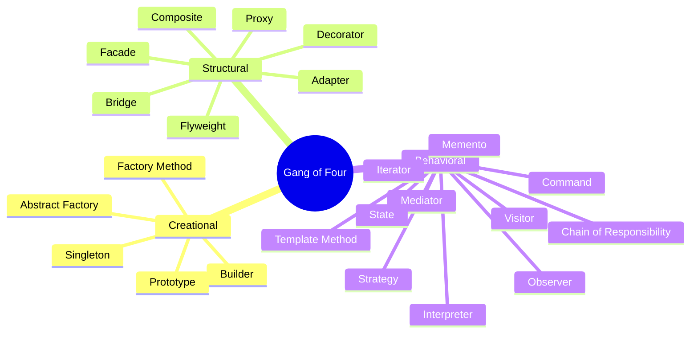

A design pattern is a named, reusable approach to a recurring problem: a template to work from, not a finished design that converts straight into code. This page catalogs the twenty-three Gang of Four patterns by family, the patterns other catalogs added around them, common concurrency patterns, and the anti-patterns worth naming. It serves a developer who needs the name other engineers will recognize.

A pattern is a concrete structure; the general rules a structure is judged against live in [Design Principles](04-design-principles.md).

## Gang of Four Patterns

Erich Gamma, Richard Helm, Ralph Johnson, and John Vlissides, *Design Patterns: Elements of Reusable Object-Oriented Software* (1994), describe twenty-three patterns in three families. This section is that catalog; nothing else on this page belongs to it.

### Creational Patterns

Creational patterns hand back an object instead of having the caller name a concrete class, which leaves the choice of class open.

| Pattern | Description |
| --------- | ------------- |
| **Abstract Factory** | Give clients one object that makes a whole matching set of products, so they never name the concrete classes in the set |
| **Builder** | Assemble a complex object in steps through a separate builder object, so the same steps can yield different end products |
| **Factory Method** | Have the base class call a creation method that subclasses override, so each subclass picks the concrete class that gets made |
| **Prototype** | Make new objects by cloning an existing one instead of calling a constructor |
| **Singleton** | Allow a class exactly one object and a single well-known way to reach it |

### Structural Patterns

Structural patterns compose classes and objects into larger structures without rewriting the parts.

| Pattern | Description |
| --------- | ------------- |
| **Adapter** | Translate one interface into the one a client expects, so classes that could not be combined now cooperate |
| **Bridge** | Split a class into a high-level side and an implementation side joined by a reference, so each side grows without multiplying subclasses |
| **Composite** | Build trees in which a single item and a group of items answer the same interface, so clients need not tell them apart |
| **Decorator** | Wrap an object in another with the same interface to add behavior at runtime, instead of writing a subclass for each combination |
| **Facade** | Put one simple entry point in front of a complex subsystem, so clients need not learn its many parts |
| **Flyweight** | Keep common state in a few shared objects, so very many small objects use little memory |
| **Proxy** | Put a placeholder with the same interface in front of an object, to control, delay, or watch access to it |

### Behavioral Patterns

Behavioral patterns assign responsibility between objects and decouple senders from receivers.

| Pattern | Description |
| --------- | ------------- |
| **Chain of Responsibility** | Hand a request to the first of a line of handlers; each one either deals with it or passes it on |
| **Command** | Turn a request into an object, so it can be stored, queued, logged, or reversed |
| **Interpreter** | Model each rule of a small language as a class, and evaluate a sentence by walking the tree built from those classes |
| **Iterator** | Step through a collection one element at a time, with no knowledge of how it stores them |
| **Mediator** | Have objects talk through one central coordinator instead of holding references to each other |
| **Memento** | Save a snapshot of an object's state so it can be rolled back later, while the object keeps its internals private |
| **Observer** | Let objects subscribe to another object and be told automatically each time it changes |
| **State** | Move the behavior of each state into its own object, so the owner seems to switch class when its state changes |
| **Strategy** | Put each variant of an algorithm in its own object behind a shared interface, so callers can swap variants at runtime |
| **Template Method** | Fix the order of steps in a base-class method, and leave some of those steps for subclasses to fill in |
| **Visitor** | Move an operation out of the classes it works on into a separate object, so adding an operation leaves those classes unchanged |

## Patterns Beyond the Gang of Four

These are in wide use and often listed alongside the catalog above, but they are not part of it.

### Additional Creational Patterns

| Pattern | Description |
| --------- | ------------- |
| **Object Pool** | Keep costly objects in a pool and lend them out again, instead of creating and destroying one for each use |
| **Multiton** | Keep one instance per key, reached through a registry |
| **Lazy Initialization** | Create an object, or compute a value, only when something first needs it |

### Additional Structural Patterns

| Pattern | Description |
| --------- | ------------- |
| **Module/Namespace** | Group related elements into one named unit with a controlled surface |
| **Twin** | Simulate multiple inheritance, where the language lacks it, with a pair of classes that each point to the other |
| **Marker Interface** | An interface with no methods, used only to label a class so a framework can check for the label at runtime |

### Additional Behavioral Patterns

| Pattern | Description |
| --------- | ------------- |
| **Publish/Subscribe** | Observer routed through a broker or event bus, so publishers and subscribers never hold a reference to each other |
| **Servant** | Put behavior shared by several classes into one object that operates on them |
| **Null Object** | Supply an object with neutral behavior instead of a null reference |

### Patterns from Other Catalogs

- **Front Controller** — one entry point that receives every request for a web application and dispatches it to a handler. Martin Fowler, *Patterns of Enterprise Application Architecture* (2002).
- **Specification** — a business rule as an object, combinable with and, or, and not. Eric Evans, *Domain-Driven Design* (2003).
- **RAII**, resource acquisition is initialization — tie a resource to the lifetime of an object, so destroying the object releases the resource. A C++ idiom named by Bjarne Stroustrup; it manages a resource rather than creating an object, so it belongs to no Gang of Four family.

## Concurrency Patterns

Active Object, Reactor, and the Double-Checked Locking optimization are cataloged in Douglas Schmidt, Michael Stal, Hans Rohnert, and Frank Buschmann, *Pattern-Oriented Software Architecture, Volume 2: Patterns for Concurrent and Networked Objects* (2000). Doug Lea's *Concurrent Programming in Java* is the standard reference for the lock, guard, and thread-pool material.

| Pattern | Description |
| --------- | ------------- |
| **Lock** | Let one thread claim a resource, so other threads must wait before they use or change it |
| **Active Object** | Give an object its own thread of control and turn calls on it into messages that thread processes |
| **Balking** | Return without acting when the object is not in a state where the action makes sense |
| **Thread Pool** | Serve tasks from a queue with a fixed set of reusable worker threads |
| **Binding Properties** | Keep two properties in step by having each observe the other |
| **Double-Checked Locking** | Test the condition before and after taking the lock, so the lock is taken only when it is needed |
| **Guarded Suspension** | Make a caller wait until it holds the lock and the condition it needs is true |
| **Join** | Coordinate concurrent messages, so an action runs only once every message it names has arrived |
| **Reactor** | Wait on several event sources at once and dispatch each event to its handler |

## Anti-Patterns

An anti-pattern is a solution people keep choosing that reliably ends badly. Symptoms in code that already exists — a class grown too large, structure that is hard to follow, unexplained literals, leaky encapsulation — are cataloged as [Code Smells](06-code-smells.md). Duplication is covered by DRY in [Design Principles](04-design-principles.md).

### Software Design Anti-Patterns

| Anti-Pattern | Description |
| -------------- | ------------- |
| **Big Ball of Mud** | A system whose structure has decayed until no design can be seen in it; named by Brian Foote and Joseph Yoder in 1997 |
| **Abstraction Inversion** | Hiding a capability that callers need, so they must rebuild it awkwardly on top of the abstraction |
| **Gold Plating** | Polishing work further after the extra effort has stopped adding value |
| **Inner-Platform Effect** | A system that offers so much configuration that it ends up rebuilding, badly, the features of the platform beneath it |
| **Interface Bloat** | An interface that grows so many methods that writing a real implementation of it becomes impractical |

### OOP Anti-Patterns

| Anti-Pattern | Description |
| -------------- | ------------- |
| **Anemic Domain Model** | A domain model that holds data only, with the business logic that belongs to it placed elsewhere |
| **Poltergeists** | Objects that live briefly and exist only to hand data or calls on to some other object |
| **Yo-yo Problem** | An inheritance hierarchy so deep that following one behavior means jumping up and down between many classes |

### Programming Anti-Patterns

| Anti-Pattern | Description |
| -------------- | ------------- |
| **Cargo Cult Programming** | Copying patterns, tools, or rituals without understanding what they are for |
| **Lasagna Code** | So many layers of indirection that a small change has to be threaded through every one of them |
