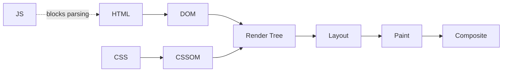

This guide covers the techniques that speed up the render path and the network. The metrics and budgets they are measured against are in [Performance Optimization](03-performance-optimization.md); JavaScript execution and bundle size are in [JavaScript and Bundle Performance](05-javascript-bundle-performance.md).

## Rendering Optimization

### Critical Rendering Path

- CSS blocks rendering: nothing paints until the CSSOM is built.
- Scripts block parsing unless marked `async` or `defer`.

The [DOM and the browser APIs](02-browser-technologies.md) themselves are covered separately.



Inline the CSS the first screen needs, and load the rest without blocking the render:

```html
<!-- Critical CSS, inlined in <head> -->
<style>
  .header { display: flex; background: #fff; }
  .hero { min-height: 100vh; }
</style>

<!-- Everything else: fetched at high priority, applied once it lands -->
<link rel="preload" href="/styles/main.css" as="style"
      onload="this.onload=null; this.rel='stylesheet'">
<noscript><link rel="stylesheet" href="/styles/main.css"></noscript>
```

### Layout Thrashing

The browser recalculates layout repeatedly because reads and writes interleave: every read after a write forces the pending layout to be flushed.

```javascript
// Bad - alternating read/write forces a reflow per iteration
elements.forEach((element) => {
    const height = element.offsetHeight;         // read, flushes layout
    element.style.height = (height + 10) + 'px'; // write, invalidates it again
});

// Good - all reads, then all writes: one layout pass
const heights = Array.from(elements, (el) => el.offsetHeight);
elements.forEach((element, i) => {
    element.style.height = (heights[i] + 10) + 'px';
});
```

| Category | Layout-Triggering Properties |
| --- | --- |
| **Dimensions** | `width`, `height`, `padding`, `margin`, `border` |
| **Position** | `top`, `right`, `bottom`, `left` |
| **Metrics read from JavaScript** | `offsetWidth`, `offsetHeight`, `getBoundingClientRect()` |

### Paint and Composite

Animate `transform` and `opacity` where you can: they skip layout and paint and run on the compositor.

```css
/* Cheap - compositor only */
.slide-in { transform: translateX(100px); opacity: 0.5; }

/* Expensive - every frame re-runs layout and paint */
.slide-in-slow { left: 100px; width: 200px; background-color: red; }

/* Promote a layer just before a complex animation, then drop the hint */
.hero.is-animating { will-change: transform; }
```

Leaving `will-change` on an element permanently keeps its layer alive and costs memory. Scope it to a class you add and remove.

---

## Network Optimization

### Compression

- Serve text — HTML, CSS, JavaScript, SVG, JSON — with `Content-Encoding: br` or `gzip`, selected from the client's `Accept-Encoding`.
- Exclude already-compressed binaries (WebP, AVIF, MP4, WOFF2). They do not shrink further, so the CPU cost buys nothing.
- This is server or CDN configuration, not application code.

### HTTP Caching

| Resource | Example `Cache-Control` | Reason |
| --- | --- | --- |
| **HTML** | `no-cache` | Stored, but revalidated every time, so a deploy is picked up at once |
| **Versioned CSS, JS, images** | `public, max-age=31536000, immutable` | The filename changes when the bytes change, so the old URL never needs revalidating |
| **API responses** | `max-age=60, stale-while-revalidate=300` | Short freshness, then a window where the stale copy is served while the refresh runs in the background |
| **User-specific data** | `no-store` | Never written to any cache, shared or private |

- `no-cache` does not mean "do not cache". It means "cache it, but revalidate before each use". `no-store` forbids storage.
- `s-maxage` overrides `max-age` for shared caches such as a CDN, and is ignored by the browser.
- `Vary: Accept-Encoding` stops a shared cache from handing a Brotli body to a client that only asked for gzip. `ETag` supplies the validator that revalidation compares.

Header syntax and the rest of HTTP's semantics are in [Client-Server Communication](../03-system-design/06-client-server-communication.md). Caching as a system-design concept is in [Caching](../03-system-design/03-caching.md).

A [service worker](02-browser-technologies.md) can implement stale-while-revalidate for requests the HTTP cache does not cover:

```javascript
self.addEventListener('fetch', (event) => {
    if (event.request.method !== 'GET') return; // cache.put rejects on non-GET

    event.respondWith(
        caches.open(CACHE_NAME).then(async (cache) => {
            const cached = await cache.match(event.request);
            const fresh = fetch(event.request).then((response) => {
                cache.put(event.request, response.clone());
                return response;
            });

            if (cached) {
                fresh.catch(() => {}); // a failed background refresh is not fatal
                return cached;         // ...but an unhandled rejection is noisy
            }
            return fresh;
        })
    );
});
```

### Resource Hints

```html
<!-- Preload resources this page needs but the parser finds late -->
<link rel="preload" href="/scripts/main.js" as="script">
<link rel="preload" href="/fonts/inter.woff2" as="font" crossorigin>
<!-- Preload the LCP image and raise its priority -->
<link rel="preload" href="/hero.avif" as="image" fetchpriority="high">
<!-- Resolve DNS early for a third-party domain -->
<link rel="dns-prefetch" href="https://api.example.com">
<!-- Full connection setup (DNS, TCP, TLS) for an origin used immediately -->
<link rel="preconnect" href="https://cdn.example.com" crossorigin>
<!-- Fetch a likely next page at low priority -->
<link rel="prefetch" href="/dashboard" as="document">
```

Preload what the current page needs; prefetch what the next page probably needs. Preloading something the page does not use costs bandwidth and delays real work.

### Script Loading

```html
<!-- Default: blocks the parser while it downloads and runs -->
<script src="main.js"></script>
<!-- async: downloads in parallel, runs as soon as it arrives, order not guaranteed -->
<script src="analytics.js" async></script>
<!-- defer: downloads in parallel, runs after parsing, in document order -->
<script src="app.js" defer></script>
<!-- Modules are deferred by default -->
<script type="module" src="module.js"></script>
```

Use `async` for scripts nothing else depends on, and `defer` for application code that must run in order.

### Image Optimization

| Format | Best For |
| --- | --- |
| **AVIF** | Photographs, where it usually compresses smallest |
| **WebP** | Photographs, where reach matters more than the last few kilobytes — both formats are in every major engine as of 2026, but WebP's support in older browsers and in image tooling is still wider |
| **SVG** | Icons, logos, and line art, which stay sharp at any size |

```html
<!-- Responsive: the browser picks a candidate using srcset and sizes.
     width and height reserve the space, which is what prevents layout shift. -->


<!-- Format fallback: the first source the browser understands wins -->
<picture>
    <source srcset="image.avif" type="image/avif">
    <source srcset="image.webp" type="image/webp">
    
</picture>
```

Never put `loading="lazy"` on the LCP image. It delays the fetch until layout has run — on the exact element whose render time is measured.
