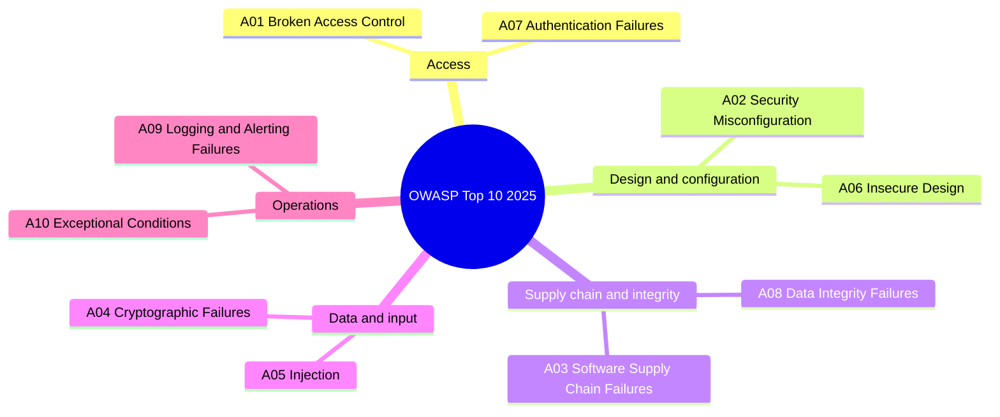
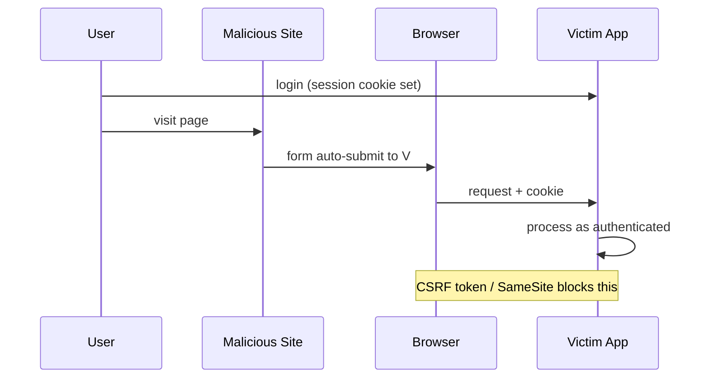

Web application security is the work of keeping an application's data and actions reachable only by the people entitled to them. This guide covers the principles that hold across attack classes, the OWASP Top 10 as of its 2025 edition, the common vulnerabilities, and authentication. The concrete defenses that implement them — headers, CSP, dependency checks, client-side storage — are in [Web Security Defenses](08-web-security-defenses.md).

## Core Principles

These hold across every attack class in this guide and in [Web Security Defenses](08-web-security-defenses.md). Each one can be checked in a review.

| Principle | What to check |
| --- | --- |
| **Defense in depth** | No attack is stopped by one control alone: XSS meets escaping and a [CSP](08-web-security-defenses.md#content-security-policy-csp), CSRF meets a token and a `SameSite` cookie |
| **Least privilege** | Every user, token, and embedded frame gets only the access its task needs: scoped tokens, a [sandboxed iframe](08-web-security-defenses.md#iframe-security), unused features turned off in `Permissions-Policy` |
| **Never trust input** | Every request is validated on the server against an allowlist; client-side validation helps the user but is not a control — see [XSS](07-security-web.md#cross-site-scripting-xss) and [SQL Injection](07-security-web.md#sql-injection) |
| **Secure by default** | The safe path needs no extra code and the unsafe one is explicit: React escapes output unless `dangerouslySetInnerHTML` is used, and a CSP starts from `default-src 'self'` |
| **Fail securely** | An error denies the request and reveals nothing internal, such as a stack trace or query text (A10 below) |
| **Minimize attack surface** | Features, endpoints, and dependencies that are not used are removed, not just left unlinked (A02 and A03 below, [Dependency Security](08-web-security-defenses.md#dependency-security)) |
| **Keep secrets out of the client** | Nothing in the bundle, the HTML, or [browser storage](08-web-security-defenses.md#storage) is secret: server API keys and signing secrets stay on the server, and session tokens live in `HttpOnly` cookies ([Token-Based Authentication](07-security-web.md#token-based-authentication)) |
| **Encrypt everything in transit** | Every response is served over HTTPS, with [HSTS](08-web-security-defenses.md#security-headers) so the browser refuses a downgrade |

## OWASP Top 10 (2025)

| Rank | Category | Description |
| --- | --- | --- |
| **A01** | Broken Access Control | Users reach resources or actions their permissions do not cover |
| **A02** | Security Misconfiguration | Insecure defaults, unnecessary features, missing hardening |
| **A03** | Software Supply Chain Failures | Compromised or unvetted dependencies, build systems, and distribution |
| **A04** | Cryptographic Failures | Weak, missing, or misapplied encryption |
| **A05** | Injection | Untrusted input interpreted as code or query syntax |
| **A06** | Insecure Design | Security controls missing or inadequate in the design itself |
| **A07** | Authentication Failures | Weak credentials, missing rate limiting, broken session handling |
| **A08** | Software or Data Integrity Failures | Unverified updates, insecure deserialization, tampered artifacts |
| **A09** | Security Logging and Alerting Failures | Logging that is missing, inadequate, or never monitored |
| **A10** | Mishandling of Exceptional Conditions | Errors and edge cases handled in ways that leak data or fail open |

Category names from [OWASP Top 10:2025](https://owasp.org/Top10/2025/), © OWASP Foundation, licensed [CC BY-SA 4.0](https://creativecommons.org/licenses/by-sa/4.0/); the descriptions are this book's own.

Changes from the 2021 edition:

- SSRF is no longer a standalone category.
- Mishandling of Exceptional Conditions is new.
- Supply chain risk grew from Vulnerable and Outdated Components into its own category at A03.



## Common Vulnerabilities

### Cross-Site Scripting (XSS)

An attacker injects malicious scripts into pages that other users view. Three types:

- **Stored** — persisted in the database
- **Reflected** — carried in the URL
- **DOM-based** — produced by client-side JavaScript

```javascript
// React escapes by default - SAFE
<div>{userInput}</div>

// Bypasses escaping - DANGEROUS with unsanitized input
<div dangerouslySetInnerHTML={{ __html: userInput }} />

// Safe when required
import DOMPurify from 'dompurify';
<div dangerouslySetInnerHTML={{ __html: DOMPurify.sanitize(userInput) }} />
```

| Technique | Priority |
| --- | --- |
| **Content escaping (React default)** | Always |
| **Input validation (allowlist)** | High |
| **CSP headers** | High |
| **Sanitization with DOMPurify** | When rendering HTML |

### Cross-Site Request Forgery (CSRF)

An attacker tricks an authenticated user into sending an unintended request through their active session.

**Attack:** user visits a malicious page → browser sends the user's cookies to the victim's bank → bank processes the request.



```javascript
// 1. CSRF Token
const csrfToken = document.querySelector('meta[name="csrf-token"]').content;
fetch('/api/action', {
    method: 'POST',
    headers: { 'X-CSRF-Token': csrfToken, 'Content-Type': 'application/json' },
    body: JSON.stringify({ data })
});

// 2. SameSite Cookie
// Set-Cookie: sessionid=abc123; SameSite=Strict; Secure; HttpOnly

// 3. Custom header - a cross-origin <form> cannot set one at all, and a
//    fetch/XHR that does triggers a CORS preflight the server must approve
fetch('/api/action', {
    method: 'POST',
    headers: { 'X-Requested-With': 'XMLHttpRequest' }
});
```

### Same-Origin Policy and CORS

Browsers restrict how a page from one origin accesses resources from another. An origin is protocol + host + port; any difference makes a different origin.

| URL | Same Origin? | Reason |
| --- | --- | --- |
| **`https://example.com/other`** | Yes | Different path only |
| **`http://example.com/page`** | No | Different protocol |
| **`https://api.example.com/page`** | No | Different subdomain |
| **`https://example.com:8080/page`** | No | Different port |

```javascript
// Express CORS setup
app.use((req, res, next) => {
    res.header('Access-Control-Allow-Origin', 'https://trusted-site.com');
    res.header('Access-Control-Allow-Methods', 'GET, POST, PUT, DELETE');
    res.header('Access-Control-Allow-Headers', 'Content-Type, Authorization');
    if (req.method === 'OPTIONS') return res.sendStatus(200);
    next();
});
```

### SQL Injection

```javascript
// Bad - string concatenation
const query = "SELECT * FROM users WHERE id = " + userId;

// Good - parameterized
const query = "SELECT * FROM users WHERE id = ?";
db.execute(query, [userId]);

// Good - ORM
const user = await User.findById(userId);
```

## Authentication and Sessions

### Token-Based Authentication

```javascript
// JWT structure: header.payload.signature
const token = {
    payload: {
        sub: "user123",
        exp: 1516242622,
        scope: "read write"
    }
};

// Storage preference:
// Best: HTTP-only Secure cookie (not accessible via JS)
// Acceptable: In-memory variable
// Never: localStorage (XSS exposes all data)

// Set-Cookie: token=eyJhbGci...; HttpOnly; Secure; SameSite=Lax; Path=/; Max-Age=3600
```

**Password rules:**

| Practice | Implementation |
| --- | --- |
| **Minimum length** | At least 15 characters when the password is the only factor, 8 when it is part of multi-factor authentication (NIST SP 800-63B-4) |
| **Hashing** | bcrypt with an appropriate work factor |
| **Rate limiting** | Prevent brute force |
| **Account lockout** | Temporary lock after failures |
| **2FA** | Multi-factor authentication |

### Session Configuration

```javascript
const sessionConfig = {
    name: 'session_id',
    secret: 'strong-random-secret',
    resave: false,
    saveUninitialized: false,
    cookie: {
        httpOnly: true,
        secure: true,
        sameSite: 'strict',
        maxAge: 3600000
    }
};
```
