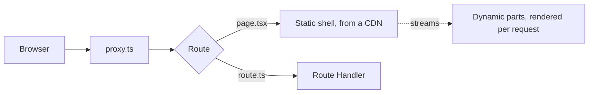
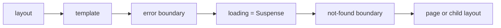
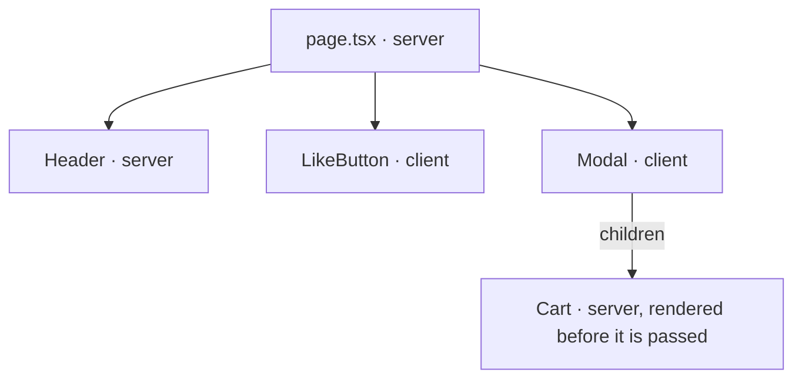
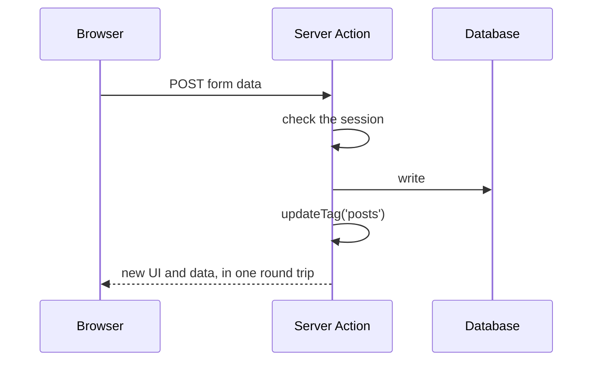

Next.js is a React framework that decides, per component, where HTML is produced: at build time, from a cache, or per request. This guide distills the official documentation as of **Next.js 16.4** (October 2026, React 19.3) and covers the App Router only. The rendering models it combines — SSR, static generation, ISR, hydration, streaming — are defined in [Application Types](01-application-types.md#server-side-rendering-ssr); this guide shows how Next.js names and controls them.

| Fact | Value |
| --- | --- |
| **Requirements** | Node.js 20.9+, TypeScript 5.1+, Chrome/Edge/Firefox 111+, Safari 16.4+ |
| **Bundler** | Turbopack, the default for `next dev` and `next build`; `--webpack` opts out |
| **Default component** | Server Component; `'use client'` opts a module graph into the browser |
| **Caching** | Opt-in with `'use cache'` under Cache Components, which becomes the default in Next.js 17 |
| **Request interception** | `proxy.ts`, which replaced `middleware.ts` in 16.0 |



## Setup

```bash
npx create-next-app@latest my-app   # TypeScript, Tailwind, ESLint, App Router, Cache Components
npm run dev                         # next dev   — writes to .next/dev, so dev and build can run at once
npm run build && npm start          # next build — no longer runs a linter; run ESLint or Biome yourself
npx next typegen                    # generates the PageProps, LayoutProps and RouteContext helpers
```

```ts
// next.config.ts
import type { NextConfig } from 'next'

const nextConfig: NextConfig = {
  cacheComponents: true,     // Cache Components and Partial Prerendering
  partialPrefetching: true,  // set it explicitly; leaving it unset logs a warning
  images: { remotePatterns: [{ protocol: 'https', hostname: 'cdn.example.com' }] },
}

export default nextConfig
```

## Project Structure

Folders under `app/` are URL segments. A segment becomes public only when it holds a `page` or a `route` file, so other files can live beside them safely.

| File | Role |
| --- | --- |
| `layout.tsx` | UI shared by a segment and its children; keeps state across navigation. The root layout must render `<html>` and `<body>` |
| `page.tsx` | The UI of a route; makes the segment public |
| `loading.tsx` | Suspense fallback for the segment |
| `error.tsx` | Error boundary for the segment; must be a Client Component |
| `global-error.tsx` | Error boundary for the root layout; renders its own `<html>` and `<body>` |
| `not-found.tsx` | UI for `notFound()` and unmatched URLs |
| `template.tsx` | Like a layout, but re-mounted on every navigation |
| `default.tsx` | Fallback for a parallel-route slot; **required** for every slot since 16.0 |
| `route.ts` | HTTP endpoint; cannot share a segment with `page.tsx` |
| `proxy.ts`, `instrumentation.ts` | Project root (or `src/`): request interception, and server start-up hooks |

| Folder | Meaning | Example → URL |
| --- | --- | --- |
| `[slug]` | Dynamic segment | `blog/[slug]` → `/blog/hello` |
| `[...slug]` | Catch-all | `shop/[...slug]` → `/shop/a/b` |
| `[[...slug]]` | Optional catch-all | `docs/[[...slug]]` → `/docs` and `/docs/a` |
| `(group)` | Groups routes and layouts; left out of the URL | `(shop)/cart` → `/cart` |
| `_folder` | Private; never routed | `blog/_lib/data.ts` |
| `@slot` | Parallel route, passed to the parent layout as a prop | `@team`, `@analytics` |
| `(.)x` `(..)x` `(...)x` | Intercepting route: same level, one up, from root | a photo modal over a feed |

Within one segment, the special files nest in a fixed order; a child segment renders inside its parent's `page` position.



```tsx
// app/dashboard/error.tsx — error boundaries run in the browser
'use client'
export default function Error({ retry }: { error: unknown; retry: () => void }) {
  return <button onClick={() => retry()}>Try again</button>
}
```

```tsx
// app/dashboard/layout.tsx — each @slot folder arrives as a prop
export default function Layout({ children, team, analytics }: LayoutProps<'/dashboard'>) {
  return <>{children}{team}{analytics}</>
}
```

Metadata is code too: export `metadata` or `generateMetadata` from a layout or page, or add `favicon.ico`, `icon`, `opengraph-image`, `sitemap.ts` and `robots.ts` files.

```tsx
export async function generateMetadata(props: PageProps<'/blog/[slug]'>) {
  const { slug } = await props.params
  return { title: slug, openGraph: { images: [`/og/${slug}.png`] } }
}
```

## Routing and Navigation

Since 16.0, `params` and `searchParams` are **Promises only**; the synchronous access kept for compatibility in 15 is removed. The same holds for `cookies()`, `headers()` and `draftMode()`.

```tsx
// app/blog/[slug]/page.tsx
export default async function Page(props: PageProps<'/blog/[slug]'>) {
  const { slug } = await props.params
  return <h1>{slug}</h1>
}
```

| Need | API (all from `next/navigation` unless noted) |
| --- | --- |
| Link with prefetch | `<Link href="/about">` from `next/link`; `prefetch={true}` also prefetches content that depends on the URL |
| Navigate from code | `useRouter()` → `push`, `replace`, `back`, `refresh`, `prefetch` (Client Components) |
| Read the URL | `usePathname()`, `useSearchParams()`, `useParams()` (Client Components) |
| Redirect or 404 on the server | `redirect('/login')`, `permanentRedirect()`, `notFound()` — each throws, so code after it does not run |

```tsx
'use client'
import Link from 'next/link'
import { usePathname, useRouter } from 'next/navigation'

export function Nav() {
  const router = useRouter()
  const current = usePathname() === '/about' ? 'page' : undefined
  return (
    <nav>
      <Link href="/about" aria-current={current}>About</Link>
      <button onClick={() => router.push('/login')}>Log in</button>
    </nav>
  )
}
```

## Server and Client Components

Layouts and pages are Server Components. They render to the RSC payload — the serialized component tree — which the browser uses to build the HTML and reconcile with Client Components.

| Use a Server Component to | Use a Client Component (`'use client'`) for |
| --- | --- |
| Read a database or API near its source | State and event handlers: `useState`, `onClick` |
| Use secrets and API keys | Effects and custom hooks |
| Keep large dependencies out of the bundle | Browser APIs: `window`, `localStorage` |



```tsx
// app/ui/like-button.tsx
'use client'
import { useState } from 'react'

export function LikeButton({ likes }: { likes: number }) {
  const [count, setCount] = useState(likes)
  return <button onClick={() => setCount(count + 1)}>Like {count}</button>
}
```

- `'use client'` marks a **boundary**: the file, everything it imports, and everything it renders directly join the client bundle. Place it on the interactive leaves, not near the root.
- A Server Component passed as `children` (or any prop) to a Client Component stays on the server; it arrives already rendered.
- Props that cross the boundary must be serializable by React: no functions except Server Actions, no class instances.
- React context does not work in Server Components. Wrap the provider in a Client Component and render it as deep as possible.
- `import 'server-only'` turns an accidental client import of a module into a build error. Only `NEXT_PUBLIC_*` variables reach the bundle; any other `process.env` read becomes an empty string there.

## Caching and Rendering

With Cache Components, **nothing is cached unless marked**, and every route still produces a static shell. Each component lands in one of three places:

| Content | How to write it | Where it goes |
| --- | --- | --- |
| **Static** | Pure computation, module imports, synchronous I/O | Prerendered into the static shell at build time |
| **Cached** | `'use cache'` with a `cacheLife` | Prerendered into the shell, refreshed by its lifetime or a tag |
| **Dynamic** | Uncached fetch, `cookies()`, `headers()`, `searchParams`, `connection()` | Streamed at request time behind a `<Suspense>` fallback |

This mix in one response is **Partial Prerendering**: the shell can be served from a CDN, and the dynamic holes stream in after it. An uncached read outside `<Suspense>` is reported as an error in development, the **blocking-route** insight, so a route cannot quietly become fully dynamic.

```tsx
import { Suspense } from 'react'
import { cookies } from 'next/headers'
import { cacheLife, cacheTag } from 'next/cache'

export default function Page() {
  return (
    <>
      <h1>Blog</h1>                                         {/* static */}
      <Posts />                                             {/* cached */}
      <Suspense fallback={<p>Loading…</p>}><Theme /></Suspense> {/* dynamic */}
    </>
  )
}

async function Posts() {
  'use cache'
  cacheLife('hours')
  cacheTag('posts')
  const posts = await db.posts.findMany()
  return <ul>{posts.map((p) => <li key={p.id}>{p.title}</li>)}</ul>
}

async function Theme() {
  const theme = (await cookies()).get('theme')?.value ?? 'light'
  return <p>Theme: {theme}</p>
}
```

- **Cache key.** Arguments and captured variables are part of the key. Read `cookies()` outside the cached function and pass the value in, so the result is cached per value.
- **Variants.** `'use cache'` is in memory per instance, which does not survive between serverless requests. `'use cache: remote'` uses a shared cache handler. `'use cache: private'` may read cookies and headers directly and is cached only in the browser.
- **Placement.** Put the directive at the top of a function, component or file. Await runtime data as deep in the tree as possible: a layout that awaits `params` cannot be prerendered, while one that passes the Promise down can.
- **Random values and time.** `Math.random()`, `Date.now()` and `crypto.randomUUID()` must follow `await connection()` inside `<Suspense>` (one value per request) or sit inside `'use cache'` (one shared value).
- **Guarantees.** `export const ensureStatic = 'navigation'` (16.4) fails the build if any dynamic content enters the route; `'shell'` and `'prefetch'` are weaker levels.

| `cacheLife` profile | `stale` (browser) | `revalidate` (server, in the background) | `expire` (server, blocking) |
| --- | --- | --- | --- |
| `default` | 5 min | 15 min | never |
| `seconds` | 30 s | 1 s | 1 min — too short to prerender; becomes a dynamic hole |
| `minutes` | 5 min | 1 min | 1 h |
| `hours` | 5 min | 1 h | 1 day |
| `days` | 5 min | 1 day | 1 week |
| `weeks` | 5 min | 1 week | 30 days |
| `max` | 5 min | 30 days | 1 year |

Every cache is scoped to one deployment: the build id is part of every key, so a new deploy starts empty. An app without `cacheComponents` follows the older model of `fetch` options and `export const dynamic`, which the docs keep as a separate guide.

## Mutations: Server Functions

A Server Function is an `async` function marked `'use server'` — at the top of the function (only inside a Server Component) or at the top of a file (whose exports Client Components may import). Used as a form action, it is called a Server Action.

```tsx
// app/actions.ts
'use server'
import { updateTag } from 'next/cache'
import { redirect } from 'next/navigation'

export async function createPost(formData: FormData) {
  const session = await auth()
  if (!session?.user) throw new Error('Unauthorized')
  await db.posts.create({ title: String(formData.get('title')) })
  updateTag('posts')
  redirect('/posts')
}
```

```tsx
<form action={createPost}><input name="title" /><button>Create</button></form>
```



- ⚠️ Every Server Function is a public `POST` endpoint, reachable without your UI. Check authentication and authorization **inside each one**; a proxy matcher does not cover it reliably.
- In a Server Component, a form with a Server Action submits even before JavaScript loads, or without it.
- The client sends Server Functions one at a time. Use them for writes, not for parallel reads.
- `useActionState(action, initial)` returns `[state, action, pending]` for validation errors and pending UI; the action then receives `(previousState, formData)`. `useFormStatus()` gives `pending` inside a form.

```tsx
'use client'
import { useActionState } from 'react'
import { savePost } from './actions' // (prev, formData) => Promise<{ error?: string }>

export function PostForm() {
  const [state, action, pending] = useActionState(savePost, {})
  return (
    <form action={action}>
      <input name="title" />
      <button disabled={pending}>Save</button>
      <p role="alert">{state.error}</p>
    </form>
  )
}
```

| After a write | Call | Effect |
| --- | --- | --- |
| The user must see their own change | `updateTag(tag)` | Expires and refetches in the same request (Server Actions only) |
| Others may see stale data briefly | `revalidateTag(tag, 'max')` | Stale-while-revalidate; the profile argument is required since 16.0 |
| A whole path changed | `revalidatePath('/posts')` | Invalidates that route |
| Only the current UI needs re-rendering | `refresh()` | Refreshes the client router; tagged data stays cached |

`after(() => …)` from `next/server` runs work such as logging or e-mail after the response is sent.

## Route Handlers

`route.ts` exports functions named after HTTP methods — `GET`, `POST`, `PUT`, `PATCH`, `DELETE`, `HEAD`, `OPTIONS` — using the Web `Request` and `Response` types. Any other method returns `405`.

```ts
// app/api/users/[id]/route.ts
export async function GET(_req: Request, ctx: RouteContext<'/api/users/[id]'>) {
  const { id } = await ctx.params
  return Response.json(await getUser(id))
}
```

Under Cache Components, `GET` follows the page model: prerendered if it reads nothing uncached, request-time otherwise. `'use cache'` cannot go in the handler body; move the cached work into a helper function. Other methods are never cached.

## Proxy

`proxy.ts` runs on the Node.js runtime before routing, and may redirect, rewrite, set headers and cookies, or answer directly. The docs call it a last resort: keep it to fast checks, not full session logic.

```ts
// proxy.ts
import { NextResponse, type NextRequest } from 'next/server'

export function proxy(request: NextRequest) {
  if (!request.cookies.has('session')) {
    return NextResponse.redirect(new URL('/login', request.url))
  }
  return NextResponse.next()
}

export const config = {
  matcher: ['/((?!api|_next/static|_next/image|favicon.ico).*)'],
}
```

- Without a `matcher`, proxy runs on **every** request, including `_next/static` and images. Matchers must be constants.
- Order: config `headers` → config `redirects` → proxy → `beforeFiles` rewrites → filesystem routes → `afterFiles` rewrites → dynamic routes → `fallback` rewrites.
- To pass data downstream, use `NextResponse.next({ request: { headers } })`. Passing `{ headers }` alone sends them to the client instead.
- The Edge runtime is not available in `proxy.ts`. An app that needs Edge keeps the deprecated `middleware.ts`.

## Assets, Environment, Instrumentation

| Concern | Essentials |
| --- | --- |
| **Images** | `<Image>` from `next/image` needs `width` and `height`, or `fill` with `sizes`. Since 16.0: `qualities` defaults to `[75]`, `minimumCacheTTL` to 4 hours, at most 3 redirects, local IPs blocked, `remotePatterns` replaces `domains` |
| **Fonts** | `next/font/google` and `next/font/local` self-host fonts at build time; the browser never calls Google |
| **Code splitting** | `next/dynamic` or `import()` in an event handler; Turbopack's bundle analyzer shows the largest routes |
| **Env variables** | `.env*.local` stays out of git. `NEXT_PUBLIC_*` is inlined at build time; read others after `await connection()` to get the runtime value. `serverRuntimeConfig` and `publicRuntimeConfig` are removed |
| **Instrumentation** | `instrumentation.ts` exports `register()` (runs once per server start; check `process.env.NEXT_RUNTIME`) and `onRequestError()` (reports server errors) |

---

## References

- [Next.js Documentation](https://nextjs.org/docs) and its [index for LLMs](https://nextjs.org/docs/llms.txt)
- [Caching](https://nextjs.org/docs/app/getting-started/caching) and [`cacheLife`](https://nextjs.org/docs/app/api-reference/functions/cacheLife)
- [Upgrading to Version 16](https://nextjs.org/docs/app/guides/upgrading/version-16)
- [Next.js 16.4 release notes](https://nextjs.org/blog/next-16-4)
- [Next.js Cheat Sheet (devsheets.io)](https://devsheets.io/sheets/nextjs)

## Related Guides

- [Application Types](01-application-types.md) — SSR, SSG, ISR and hydration, the models Next.js combines per component
- [JavaScript and Bundle Performance](05-javascript-bundle-performance.md) — code splitting and bundle size, which the server/client split controls
- [Web Application Security](07-security-web.md) — authentication and CSRF, which every Server Function must handle
