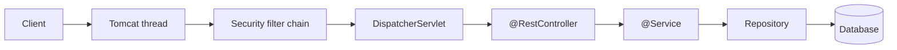
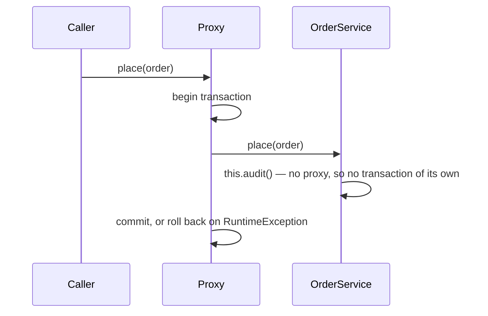
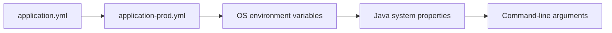

Spring Boot builds production Java services from conventions: it wires the beans an application needs from what is on the classpath, and steps back wherever the application declares its own. This guide distills the official documentation as of **Spring Boot 4.1** (Spring Framework 7.0, Spring Security 7.1) and **Java 25 LTS**, and covers the servlet stack: Spring MVC on Tomcat.

| Fact | Value |
| --- | --- |
| **Requirements** | Java 17+ (25 recommended), Maven 3.6.3+ or Gradle 8.14+/9.x, Kotlin 2.2+ |
| **Platform** | Jakarta EE 11: Servlet 6.1, JPA 3.2 — `jakarta.*` packages, never `javax.*` |
| **Server** | Embedded Tomcat 11 by default, or Jetty 12.1; Undertow was removed in 4.0 |
| **JSON** | Jackson 3, in the `tools.jackson` package |
| **Null safety** | JSpecify annotations across the Spring APIs |



## Java Essentials

Only what a Spring service uses daily, from Java 25 onwards.

| Feature | Use |
| --- | --- |
| `record Point(int x, int y) {}` | Immutable data: DTOs, configuration, events. Accessors are `x()`, not `getX()` |
| `sealed interface Shape permits Circle, Square` | A closed set of subtypes; `switch` over it is checked for exhaustiveness |
| `switch` with patterns | `case Circle(var r) -> …` destructures a record inline |
| `var`, text blocks `"""…"""` | Local type inference; multi-line strings for SQL and JSON |
| `list.stream().filter(…).map(…).toList()` | Lazy, single-use pipelines; `toList()` returns an unmodifiable list |
| `Optional` | A return type for "may be absent"; prefer `orElse`, `orElseGet`, `map` over `get()` |
| Virtual threads (Java 21+) | Cheap threads that unmount while blocked on I/O |
| `void main() { IO.println("Hi"); }` | Compact source file (Java 25); run with `java Main.java` |

```java
sealed interface Shape permits Circle, Square {}
record Circle(double r) implements Shape {}
record Square(double side) implements Shape {}

double area(Shape s) {
    return switch (s) {               // no default needed: the set is closed
        case Circle(var r) -> Math.PI * r * r;
        case Square(var side) -> side * side;
    };
}
```

## Setup

Generate the project at [start.spring.io](https://start.spring.io), then:

```bash
./mvnw spring-boot:run            # or ./gradlew bootRun
./mvnw package                    # executable jar: java -jar target/app.jar
./mvnw spring-boot:build-image    # OCI image through Cloud Native Buildpacks, no Dockerfile
```

A starter is a dependency that brings a library plus its auto-configuration. Boot 4 split them by technology:

| Need | Starter (Boot 4 name) |
| --- | --- |
| REST over Spring MVC | `spring-boot-starter-webmvc` (was `-web`) |
| JPA with Hibernate 7 | `spring-boot-starter-data-jpa` |
| Database migrations | `spring-boot-starter-flyway` or `-liquibase` — no longer implied by the library alone |
| Security, OAuth2 | `spring-boot-starter-security`, `spring-boot-starter-security-oauth2-resource-server` |
| Validation | `spring-boot-starter-validation` |
| Health, metrics | `spring-boot-starter-actuator`, `spring-boot-starter-opentelemetry` |
| Tests | `spring-boot-starter-<technology>-test`, for example `-webmvc-test` |

## Beans and Dependency Injection

A bean is an object the Spring container creates, wires, and manages. `@SpringBootApplication` combines `@Configuration`, `@ComponentScan` of its own package and below, and `@EnableAutoConfiguration`.

```java
@SpringBootApplication
public class App {
    public static void main(String[] args) { SpringApplication.run(App.class, args); }
}

@Service
class OrderService {
    private final OrderRepository orders;
    OrderService(OrderRepository orders) { this.orders = orders; } // constructor injection, no @Autowired
}
```

- **Stereotypes.** `@Component`, `@Service`, `@Repository` (adds exception translation), `@Controller` and `@RestController` all register a bean during the scan.
- **Factory methods.** `@Bean` methods in a `@Configuration` class create beans from third-party classes.
- **Back-off.** Auto-configuration is guarded by `@ConditionalOnMissingBean`: declare your own `DataSource` or `JsonMapper` and Boot's version steps aside.
- **Scope.** Beans are singletons by default, shared across threads. Keep them stateless.
- **Proxies.** `@Transactional`, `@Cacheable`, `@Async` and `@Retryable` work through a proxy around the bean, so they apply only to calls that come *through* the proxy — see [Aspect-Oriented Programming](../05-coding/03-metaprogramming.md#aspect-oriented-programming-aop).



## Configuration

`application.yml` (or `.properties`) holds defaults; `application-{profile}.yml` overrides them when the profile is active (`spring.profiles.active=prod`). Later sources win:



Relaxed binding maps `SERVER_PORT` to `server.port`, so containers configure Boot through the environment alone. Bind a group of settings to a typed, validated record rather than scattering `@Value`:

```java
@ConfigurationProperties("billing")      // billing.base-url, billing.timeout
@Validated
record BillingProperties(@NotNull URI baseUrl, Duration timeout) {}
// register with @ConfigurationPropertiesScan on the application class
```

## Web: Spring MVC

```java
@RestController
@RequestMapping("/orders")
class OrderController {
    private final OrderService service;
    OrderController(OrderService service) { this.service = service; }

    @GetMapping("/{id}")
    OrderView get(@PathVariable long id) { return service.find(id); }

    @PostMapping
    ResponseEntity<OrderView> create(@Valid @RequestBody NewOrder body) {
        var order = service.place(body);
        return ResponseEntity.created(URI.create("/orders/" + order.id())).body(order);
    }
}
```

- **Errors.** `spring.mvc.problemdetails.enabled=true` returns RFC 9457 `ProblemDetail` bodies for Spring's own exceptions. Map your exceptions in one `@RestControllerAdvice` with `@ExceptionHandler` methods.
- **API versioning (4.0).** `@GetMapping(path = "/orders", version = "2")` routes by version, read from a header, query parameter, path segment, or media type configured under `spring.mvc.apiversion.*`.
- **Virtual threads.** `spring.threads.virtual.enabled=true` (Java 21+) runs each request on a virtual thread: blocking code scales without moving to the reactive stack.
- **Reactive stack.** Spring WebFlux on Netty is the alternative for streaming and back-pressure; it is not needed for throughput once virtual threads are on.

## HTTP Clients

`RestClient` is the synchronous client for new code; the Spring team has announced `RestTemplate`'s deprecation. Better still, declare an interface and let Spring implement it:

```java
@HttpExchange("/repos")
interface GitHubClient {
    @GetExchange("/{owner}/{repo}")
    Repo repo(@PathVariable String owner, @PathVariable String repo);
}

@SpringBootApplication
@ImportHttpServices(group = "github", types = GitHubClient.class)
class App {}
// application.properties: spring.http.serviceclient.github.base-url=https://api.github.com
```

## Data: Spring Data JPA

```java
@Entity
class Customer {
    @Id @GeneratedValue Long id;
    String email;
}

interface CustomerRepository extends JpaRepository<Customer, Long> {
    Optional<Customer> findByEmail(String email);       // query derived from the method name
    @Query("select c from Customer c where c.email like %?1")
    List<Customer> byDomain(String domain);
}
```

- **Transactions.** Put `@Transactional` on service methods, not on controllers. Only unchecked exceptions roll back by default; `@Transactional(readOnly = true)` suits queries.
- **Open session in view.** `spring.jpa.open-in-view` is on by default and logs a warning: it keeps a connection open for the whole request and hides lazy-loading N+1 queries. Turn it off in services.
- **Schema.** Let Flyway or Liquibase own the schema; keep `spring.jpa.hibernate.ddl-auto` at `validate` or `none` outside tests.
- **Entities stay inside.** Return records from controllers, not entities, so the API does not change with the table.

## Security

Adding the starter secures every endpoint and logs a generated password. Replace that with a `SecurityFilterChain` bean. Since Security 7, only the lambda DSL exists — `and()` is gone.

```java
@Bean
SecurityFilterChain api(HttpSecurity http) throws Exception {
    return http
        .authorizeHttpRequests(a -> a
            .requestMatchers("/actuator/health/**").permitAll()
            .anyRequest().authenticated())
        .oauth2ResourceServer(o -> o.jwt(Customizer.withDefaults()))
        .build();
}
```

Method-level rules use `@PreAuthorize("hasRole('ADMIN')")` with `@EnableMethodSecurity`. Security 7 adds multi-factor authentication (`@EnableMultiFactorAuthentication`); passkeys through WebAuthn arrived in 6.4. The attack classes these defend against are in [Web Application Security](../06-frontend/07-security-web.md).

## Resilience and Observability

Spring Framework 7 brings retries and concurrency limits into the core, enabled by `@EnableResilientMethods` on a configuration class:

```java
@Retryable(includes = IOException.class, maxRetries = 4, delay = 100, multiplier = 2)
Rate fetchRate() { … }                  // 1 call + at most 4 retries; default 3 retries, 1 s apart

@ConcurrencyLimit(10)
Report render() { … }                   // at most 10 concurrent calls into this method
```

Actuator adds operational endpoints under `/actuator`. Over HTTP, only `health` is exposed by default; widen it with `management.endpoints.web.exposure.include`. Since 4.0, liveness and readiness probes (`/actuator/health/liveness`, `/readiness`) are on by default. Micrometer records metrics and traces; `spring-boot-starter-opentelemetry` exports them over OTLP.

## Testing

| Annotation | Loads | For |
| --- | --- | --- |
| `@SpringBootTest` | The whole context | End-to-end; add `@AutoConfigureMockMvc` or `@AutoConfigureRestTestClient` for HTTP |
| `@WebMvcTest(OrderController.class)` | MVC layer only | Controllers, validation, error mapping |
| `@DataJpaTest` | JPA layer, transaction rolled back per test | Repositories and queries |
| `@MockitoBean` | Replaces one bean with a mock | Replaces the removed `@MockBean` |
| `@ServiceConnection` on a Testcontainers field | A real database in Docker | Integration tests without hand-written connection properties |

```java
@WebMvcTest(OrderController.class)
class OrderControllerTest {
    @Autowired MockMvcTester mvc;
    @MockitoBean OrderService service;

    @Test void missingOrderIs404() {
        given(service.find(9)).willThrow(new OrderNotFound(9)); // mapped to 404 by the @RestControllerAdvice
        assertThat(mvc.get().uri("/orders/9")).hasStatus(HttpStatus.NOT_FOUND);
    }
}
```

---

## References

- [Spring Boot Reference](https://docs.spring.io/spring-boot/) and [System Requirements](https://docs.spring.io/spring-boot/system-requirements.html)
- [Spring Boot 4.0 Migration Guide](https://github.com/spring-projects/spring-boot/wiki/Spring-Boot-4.0-Migration-Guide)
- [Spring Framework 7.0 Release Notes](https://github.com/spring-projects/spring-framework/wiki/Spring-Framework-7.0-Release-Notes) and [Resilience Features](https://docs.spring.io/spring-framework/reference/core/resilience.html)
- [Spring Security Reference](https://docs.spring.io/spring-security/reference/)
- [Java Cheat Sheet (devsheets.io)](https://devsheets.io/sheets/java)

## Related Guides

- [Databases](../03-system-design/02-databases.md#transactions-and-locking) — transactions, isolation and migrations beneath Spring Data
- [Caching](../03-system-design/03-caching.md) — the strategies behind `@Cacheable`
- [Metaprogramming and AOP](../05-coding/03-metaprogramming.md) — the proxy mechanism Spring's annotations rely on
