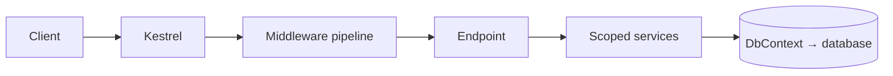
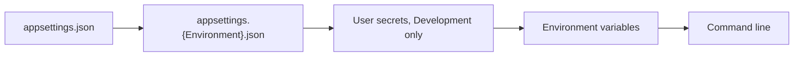

ASP.NET Core is the web framework of .NET: one hosting model, one dependency injection container, and one middleware pipeline for every kind of service. This guide distills the official documentation as of **.NET 10 LTS** (C# 14, ASP.NET Core 10, EF Core 10), and notes what **.NET 11** — at release candidate 2, general availability expected in November 2026 — changes.

| Fact | Value |
| --- | --- |
| **Current release** | .NET 10, LTS: released 2025-11-11, supported until 2028-11-14 |
| **Support rule** | Even versions are LTS (3 years); odd versions are STS (2 years, since .NET 9) |
| **Deadline** | .NET 8 and .NET 9 both leave support on **2026-11-10** |
| **API style** | Minimal APIs for new projects; controllers when their extra features are needed |
| **Server** | Kestrel, cross-platform, in-process |



## C# Essentials

Only what a service uses daily. Nullable reference types are on in every template: `string?` may be null, `string` may not, and the compiler warns on the difference.

| Feature | Use |
| --- | --- |
| `record Todo(int Id, string Title);` | Immutable data with value equality: DTOs, messages |
| `class OrderService(IOrderRepo repo)` | Primary constructor (C# 12); the usual shape for DI |
| `int[] xs = [1, 2, ..ys];` | Collection expressions (C# 12) |
| `switch` expressions with patterns | `o switch { Circle { R: var r } => …, _ => … }` |
| LINQ: `xs.Where(…).Select(…).ToList()` | Query in-memory data; EF Core translates the same syntax to SQL |
| `async`/`await`, `Task<T>` | All I/O is asynchronous; never block with `.Result` or `.Wait()` |
| `using var x = …;` | Disposes `IDisposable` at the end of the scope |
| `field` keyword (C# 14) | Reach the backing field from a property accessor |
| Extension members (C# 14) | Extension properties and static members, not only methods |
| `a?.B = x` (C# 14) | Assign only when `a` is not null |

```csharp
public static class StringExtensions
{
    extension(string s)                          // C# 14 extension block
    {
        public bool IsBlank => string.IsNullOrWhiteSpace(s);
    }
}

public class Customer
{
    public string Name { get; set => field = value.Trim(); }  // C# 14 field keyword
}
```

## Setup and CLI

```bash
dotnet new webapi -o Shop          # Minimal API project with OpenAPI
dotnet watch                       # run, and hot-reload on change
dotnet test
dotnet publish -r linux-x64 --self-contained   # Release is the default configuration
dotnet run app.cs                  # file-based app: one .cs file, no project (.NET 10)
```

A file-based app pulls packages with `#:package Name@Version` and runs as a script with a `#!/usr/bin/env dotnet` shebang. `dotnet publish app.cs` produces a Native AOT binary by default.

## Program, Dependency Injection, Configuration

`Program.cs` builds the host in two phases: register services on `builder.Services`, then build the app and describe the pipeline.

```csharp
var builder = WebApplication.CreateBuilder(args);
builder.Services.AddScoped<IOrderRepo, SqlOrderRepo>();
builder.Services.AddOptions<BillingOptions>()
    .BindConfiguration("Billing").ValidateDataAnnotations().ValidateOnStart();

var app = builder.Build();
app.MapGet("/health", () => "ok");
app.Run();
```

| Lifetime | One instance per | Rule |
| --- | --- | --- |
| **Singleton** | Application | Must be thread-safe |
| **Scoped** | HTTP request | `DbContext` lives here |
| **Transient** | Resolution | Lightweight, stateless services |

⚠️ A Scoped service injected into a Singleton becomes a **captive dependency**: it lives as long as the app and leaks state across requests. Development mode throws on it; in background work, create a scope with `IServiceScopeFactory` instead.

Configuration sources stack, and later ones win. In environment variables, `__` stands for `:`, so `Billing__BaseUrl` sets `Billing:BaseUrl`.



Read settings through the options pattern, not raw `IConfiguration`: `IOptions<T>` is read once, `IOptionsSnapshot<T>` once per request (Scoped), and `IOptionsMonitor<T>` reloads live and notifies on change.

## Web: Minimal APIs

```csharp
builder.Services.AddValidation();                       // .NET 10: DataAnnotations → 400
var todos = app.MapGroup("/todos").RequireAuthorization();

todos.MapGet("/{id:int}", async Task<Results<Ok<Todo>, NotFound>> (int id, AppDb db) =>
    await db.Todos.FindAsync(id) is { } t ? TypedResults.Ok(t) : TypedResults.NotFound());

todos.MapPost("/", async (NewTodo body, AppDb db) =>
{
    var todo = db.Todos.Add(new Todo { Title = body.Title }).Entity;
    await db.SaveChangesAsync();
    return TypedResults.Created($"/todos/{todo.Id}", todo);
});

public record NewTodo([Required, MaxLength(200)] string Title);
```

- **Binding.** Parameters come from the route, query, headers, body (JSON), or the DI container, inferred by type and name.
- **Results.** `TypedResults` with a `Results<…>` union return type documents every response in OpenAPI and is easy to assert in unit tests.
- **OpenAPI.** `AddOpenApi()` and `MapOpenApi()` generate an OpenAPI 3.1 document at build or run time; .NET 11 moves the default to 3.2.
- **Errors.** `AddProblemDetails()` with `UseExceptionHandler()` returns RFC 9457 problem bodies instead of stack traces.
- **Streaming.** `TypedResults.ServerSentEvents(…)` streams server-sent events (.NET 10).

The middleware pipeline runs in registration order on the way in and in reverse on the way out. The official order:


## Data: EF Core

```csharp
builder.Services.AddDbContext<AppDb>(o => o.UseNpgsql(builder.Configuration.GetConnectionString("Db")));

public class AppDb(DbContextOptions<AppDb> options) : DbContext(options)
{
    public DbSet<Todo> Todos => Set<Todo>();
}
```

```bash
dotnet tool install --global dotnet-ef
dotnet ef migrations add AddTodos     # generates C# migration code
dotnet ef migrations script --idempotent   # SQL to review before production
dotnet ef migrations bundle           # a self-contained executable that applies them
```

- `AddDbContext` registers the context as **Scoped**, and a `DbContext` is not thread-safe. Outside a request, use `AddDbContextFactory`.
- Queries track entities by default; add `AsNoTracking()` for read-only queries.
- Apply migrations in the deployment pipeline with a bundle or a reviewed script, not with `Database.Migrate()` at app start-up.

## Security

```csharp
builder.Services.AddAuthentication().AddJwtBearer();   // reads Authentication:Schemes:Bearer
builder.Services.AddAuthorization(o => o.AddPolicy("admin", p => p.RequireRole("admin")));
app.UseAuthentication();
app.UseAuthorization();
app.MapDelete("/todos/{id:int}", …).RequireAuthorization("admin");
```

- For APIs, cookie authentication now returns `401`/`403` instead of redirecting to a login page (.NET 10).
- ASP.NET Core Identity supports passkeys (WebAuthn) since .NET 10.
- Keep secrets in user secrets during development and in a vault or environment variables in production, never in `appsettings.json`. The attack classes are in [Web Application Security](../06-frontend/07-security-web.md).

## Performance and Operations

| Concern | API |
| --- | --- |
| **Rate limiting** | `AddRateLimiter` with fixed window, sliding window, token bucket, or concurrency policies; `.RequireRateLimiting("policy")`. Set `RejectionStatusCode = 429` |
| **Output caching** | `AddOutputCache`, `.CacheOutput()`. Caches only `200` responses to GET and HEAD, never authenticated requests or responses that set cookies |
| **Data caching** | `HybridCache`: in-memory L1 plus an optional distributed L2 such as Redis, stampede protection, and tag-based removal |
| **Health** | `AddHealthChecks()`, `MapHealthChecks("/healthz")` |
| **Logging** | `ILogger<T>`; the `[LoggerMessage]` source generator writes allocation-free log methods |
| **Native AOT** | `<PublishAot>true</PublishAot>`, `CreateSlimBuilder`, source-generated JSON. Not for MVC, Session, or authentication other than JWT |

```csharp
static partial class Log
{
    [LoggerMessage(Level = LogLevel.Information, Message = "Order {OrderId} placed")]
    public static partial void OrderPlaced(ILogger logger, int orderId);
}
```

`ConfigureAwait(false)` is not needed in ASP.NET Core application code: there is no synchronization context to return to. Library code may still use it.

## Testing

`WebApplicationFactory<Program>` from `Microsoft.AspNetCore.Mvc.Testing` starts the whole app in memory, and an `HttpClient` calls it without a network. In .NET 10, a source generator makes `Program` public for this.

```csharp
public class TodoTests(WebApplicationFactory<Program> factory)
    : IClassFixture<WebApplicationFactory<Program>>
{
    [Fact]
    public async Task UnknownTodoIs404()
    {
        var client = factory.WithWebHostBuilder(b => b.ConfigureTestServices(s =>
            s.AddSingleton<IClock, FixedClock>())).CreateClient();
        var response = await client.GetAsync("/todos/999");
        Assert.Equal(HttpStatusCode.NotFound, response.StatusCode);
    }
}
```

---

## References

- [ASP.NET Core Documentation](https://learn.microsoft.com/en-us/aspnet/core/) and [What's New in ASP.NET Core 10](https://learn.microsoft.com/en-us/aspnet/core/release-notes/aspnetcore-10.0)
- [What's New in C# 14](https://learn.microsoft.com/en-us/dotnet/csharp/whats-new/csharp-14)
- [ASP.NET Core Middleware](https://learn.microsoft.com/en-us/aspnet/core/fundamentals/middleware/) and [Best Practices](https://learn.microsoft.com/en-us/aspnet/core/fundamentals/best-practices)
- [.NET Support Policy](https://dotnet.microsoft.com/en-us/platform/support/policy/dotnet-core)
- [C# Cheat Sheet (devsheets.io)](https://devsheets.io/sheets/csharp)

## Related Guides

- [Java and Spring Boot](01-java-spring.md) — the same concerns in the JVM's mainstream stack
- [Databases](../03-system-design/02-databases.md#migrations) — migrations and transactions beneath EF Core
- [Caching](../03-system-design/03-caching.md) — the strategies behind output caching and HybridCache
